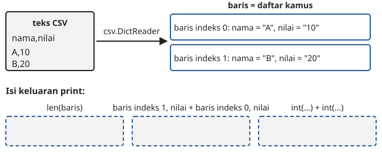

**Ingat dulu:** Tanpa melihat catatan, jawab. (1) Apa beda daftar dan kamus, dan kapan memakai masing-masing? (2) Apa beda fungsi yang `print` dan fungsi yang `return`? ______



`[Gambar: kotak teks CSV berisi "nama,nilai", "A,10", "B,20". Anak panah berlabel csv.DictReader menuju daftar baris berisi dua kamus, nama A dan nilai 10, serta nama B dan nilai 20. Di bawahnya tiga kotak kosong untuk keluaran tiga print pada soal Prediksi.]`

**Prediksi:** Teks CSV kecil dibaca dengan `csv.DictReader`. Tebak dan tulis tiga keluaran sebelum menjalankan.

```python
import csv
import io

teks = "nama,nilai\nA,10\nB,20\n"
baris = list(csv.DictReader(io.StringIO(teks)))
print(len(baris))
print(baris[1]["nilai"] + baris[0]["nilai"])
print(int(baris[1]["nilai"]) + int(baris[0]["nilai"]))
```

Isi kotak pada gambar. Mengapa baris kedua dan ketiga berbeda hasilnya? ______________________________

**Lengkapi:** Isi bagian `____` untuk menyaring `Stasiun A`, menghitung rata-rata curahnya, dan menyimpannya tanpa nomor baris. Berkas `hujan_contoh.csv` memuat kolom `tanggal`, `stasiun`, `curah_mm`, `suhu_c`.

```python setengah-jadi
import pandas as pd

df = pd.read_csv("hujan_contoh.csv")
a = df[df["stasiun"] == ____]
print(a["curah_mm"].____())
a.to_csv("stasiun_a.csv", index=____)
print(open("stasiun_a.csv", encoding="utf-8").read(), end="")
```

**Susun:** Susun baris menjadi program yang menyimpan baris berhujan ke `hujan_basah.csv` dan mencetak banyaknya. Lekukan tidak dipakai; yang diacak hanya urutannya.

```text
A. print(len(basah))
B. basah.to_csv("hujan_basah.csv", index=False)
C. import pandas as pd
D. df = pd.read_csv("hujan_contoh.csv")
E. basah = df[df["curah_mm"] > 0]
```

Urutan: ____ , ____ , ____ , ____ , ____

**Latihan:**

1. (`AI: tanpa AI`) Baca `hujan_contoh.csv` dengan `csv.DictReader` dan hitung total curah `Stasiun B`. Hati-hati dengan tipe nilainya. ______________________________
2. (`AI: tanpa AI`) Tulis langkah dalam kata untuk menghitung berapa baris yang bersuhu di atas 28 derajat, lalu tulis dengan `pandas`. ______________________________
3. (`AI: boleh`) Dari teks `"kota;suhu\nKota X;30,5\nKota Y;28,0\n"`, baca dengan pengaturan yang benar dan cetak rata-rata suhu. ______________________________

**Cek diri:**

- [ ] Saya dapat menulis dan membaca CSV dengan modul `csv`.
- [ ] Saya dapat menyaring baris dan menyimpannya tanpa indeks.
- [ ] Saya mengenali tanda berkas titik koma.

**Catatan cetak (untuk guru, tidak dicetak):** satu lembar A4, satu halaman. Kunci ada di modul `d-xi1-m4`, bagian "Kunci dan petunjuk". Lembar tidak memuat kolom nama, kelas, tanggal, atau nilai.
