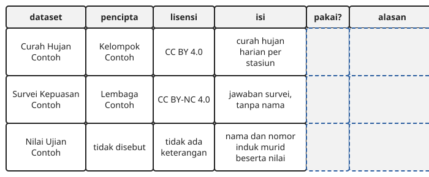

**Ingat dulu:** Tanpa melihat catatan, jawab. (1) Mengapa `csv.DictReader` mengembalikan semua nilai sebagai teks, dan apa akibatnya pada hitungan? (2) Bagaimana memeriksa lisensi sebuah dataset sebelum memakainya? ______



`[Gambar: tabel tiga dataset fiktif. Curah Hujan Contoh: pencipta Kelompok Contoh, lisensi CC BY 4.0, isi curah hujan harian per stasiun. Survei Kepuasan Contoh: Lembaga Contoh, CC BY-NC 4.0, jawaban survei tanpa nama. Nilai Ujian Contoh: pencipta tidak disebut, tidak ada keterangan lisensi, isi nama dan nomor induk murid beserta nilai. Dua kolom kosong: pakai atau tidak, dan alasan.]`

**Prediksi:** Tiga dataset fiktif pada gambar ditawarkan untuk proyek kelompok yang kelak dipajang di situs sekolah fiktif (bukan jualan). Putuskan pakai atau tidak pada tabel di gambar, dan tulis alasannya.

**Lengkapi:** Lengkapi fungsi yang menjawab apakah dataset boleh dipakai untuk proyek berbayar: `True` atau `False` bila lisensi dikenal, dan `"tidak jelas"` bila tidak.

```python setengah-jadi
KOMERSIAL = {"CC0-1.0": True, "CC-BY-4.0": True, "CC-BY-SA-4.0": True, "CC-BY-NC-4.0": False}


def boleh_untuk_proyek_berbayar(catatan):
    lisensi = catatan.get("lisensi")
    if lisensi not in ____:
        return ____
    return KOMERSIAL[____]


print(boleh_untuk_proyek_berbayar({"lisensi": "CC-BY-NC-4.0"}))
print(boleh_untuk_proyek_berbayar({"lisensi": "?"}))
```

**Susun:** Susun baris menjadi fungsi `lengkap` yang mengembalikan `False` bila salah satu kolom wajib kosong dan `True` bila semuanya terisi. Lekukan sudah benar; yang diacak hanya urutannya.

```text
A.     return True
B.             return False
C. def lengkap(catatan):
D.     for kolom in ["judul", "sumber", "lisensi"]:
E.         if not catatan.get(kolom):
```

Urutan: ____ , ____ , ____ , ____ , ____

**Latihan:**

1. (`AI: tanpa AI`) Pilih satu dataset terbuka, misalnya dari UCI Machine Learning Repository atau Portal Satu Data Indonesia. Baca sendiri keterangan lisensinya di halamannya, lalu tulis catatan sumber lengkap dan putuskan pakai atau tidak untuk proyek belajar. ______________________________
2. (`AI: tanpa AI`) Untuk tiga kasus pada gambar, tulis keputusan, alasan, dan apa yang dicantumkan di laporan bila dipakai. ______________________________
3. (`AI: boleh`) Tulis dalam kata cara membuat `boleh_untuk_proyek_berbayar` memberi peringatan bila lisensinya `CC-BY-SA-4.0`, lalu ubah ke Python. Uji dengan `CC-BY-SA-4.0` dan `CC-BY-4.0`. ______________________________

**Cek diri:**

- [ ] Saya dapat menilai sumber dari pencipta, lisensi, dokumentasi, dan data pribadi.
- [ ] Saya dapat membedakan CC0, CC BY, CC BY-SA, dan CC BY-NC secara garis besar.
- [ ] Saya tidak memakai data yang lisensinya tidak jelas.

**Catatan cetak (untuk guru, tidak dicetak):** satu lembar A4, satu halaman. Kunci ada di modul `d-xi1-m5`, bagian "Kunci dan petunjuk". Lembar tidak memuat kolom nama, kelas, tanggal, atau nilai.
