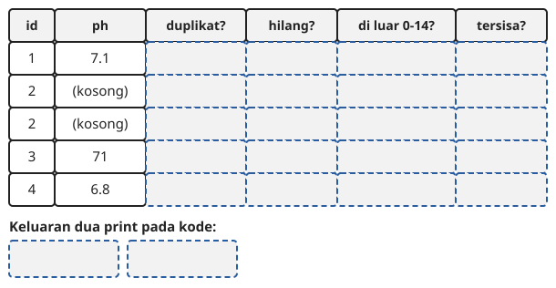

**Ingat dulu:** Tanpa melihat catatan, jawab. (1) Apa lima catatan yang disimpan untuk setiap dataset yang dipakai? (2) Mengapa `b = a` pada daftar tidak membuat salinan, dan bagaimana membuat salinan? (3) Apa yang dilakukan `index=False` saat `to_csv`? ______



`[Gambar: tabel lima baris data id dan ph karangan: (1, 7.1), (2, kosong), (2, kosong), (3, 71), (4, 6.8). Empat kolom kosong untuk diisi: duplikat atau bukan, hilang atau bukan, di luar 0 sampai 14 atau bukan, dan masih tersisa atau tidak. Di bawahnya dua kotak kosong untuk keluaran dua print.]`

**Prediksi:** Tebak dan tulis empat keluaran, baru jalankan.

```python
import pandas as pd

s = pd.Series([4, None, 6, 6])
print(round(s.mean(), 2))
print(s.isna().sum())
print(len(s.dropna()))
print(s.duplicated().sum())
```

Keluaran: ______ , ______ , ______ , ______. Apakah `mean` menghitung nilai hilang sebagai 0? ______

**Lengkapi:** Isi bagian `____` supaya program membuang duplikat, menandai pH di luar 0 sampai 14, dan menghitung nilai hilang. Data karangan sama dengan gambar.

```python setengah-jadi
import io

import pandas as pd

mentah = "id,ph\n1,7.1\n2,\n2,\n3,71\n4,6.8\n"
df = pd.read_csv(io.StringIO(mentah))
print(df.duplicated().____())
df = df.____()
salah = (df["ph"] < 0) | (df["ph"] ____ 14)
df.loc[salah, "ph"] = float("nan")
print(df["ph"].isna().____())
```

Isi tabel pada gambar dengan penelusuranmu.

**Susun:** Susun baris menjadi program yang mengubah teks menjadi angka, membuang duplikat, membuang baris tanpa pH, dan mencetak banyak baris tersisa. `dropna` harus sesudah `to_numeric`.

```text
A. bersih = df.dropna(subset=["ph"])
B. df = df.drop_duplicates()
C. import io
D. print(len(bersih))
E. df["ph"] = pd.to_numeric(df["ph"], errors="coerce")
F. import pandas as pd
G. df = pd.read_csv(io.StringIO("id,ph\n1,7.1\n1,7.1\n2,tidak ada\n3,6.8\n"))
```

Urutan: ____ , ____ , ____ , ____ , ____ , ____ , ____

**Latihan:**

1. (`AI: tanpa AI`) Untuk `pd.Series([10, 12, None, 12, 300])`: berapa nilai hilang, berapa duplikat? Setelah membuang duplikat, menandai nilai di atas 100 sebagai hilang, dan membuang yang hilang, tinggal berapa nilai dan berapa rata-ratanya? ______________________________
2. (`AI: tanpa AI`) Sebuah CSV berat paket karangan (kolom `id`, `berat_kg`) berisi `abc`, angka negatif, dan nilai 250. Tulis langkah pembersihan dalam kata-kata dan rentang yang kamu pilih beserta alasannya, lalu baru kode. ______________________________
3. (`AI: boleh`) Tulis tiga baris catatan pembersihan untuk datamu sendiri: temuan, jumlah baris, tindakan, alasan. ______________________________

**Cek diri:**

- [ ] Saya dapat menghitung nilai hilang dan duplikat.
- [ ] Saya dapat mengubah teks menjadi angka dengan `to_numeric` dan menangani yang gagal.
- [ ] Saya mencatat tiap langkah pembersihan bersama jumlah barisnya.

**Catatan cetak (untuk guru, tidak dicetak):** satu lembar A4, satu halaman. Kunci ada di modul `d-xi1-m6`, bagian "Kunci dan petunjuk". Lembar tidak memuat kolom nama, kelas, tanggal, atau nilai.
