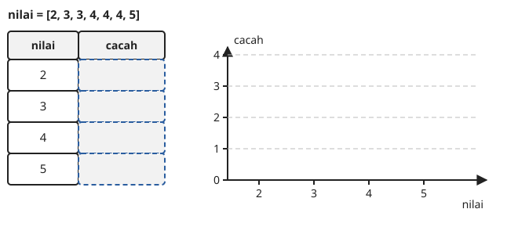

**Ingat dulu:** Tanpa melihat catatan, jawab. (1) Apa tiga pemeriksaan pertama pada tabel yang baru dibaca, dan fungsi `pandas` apa untuk tiap pemeriksaan? (2) Grafik apa untuk membandingkan, melihat perubahan, melihat hubungan, dan melihat sebaran? ______



`[Gambar: tabel frekuensi dengan nilai 2, 3, 4, 5 dan kolom cacah yang kosong untuk daftar nilai 2, 3, 3, 4, 4, 4, 5. Di kanannya sumbu kosong dengan nilai 2 sampai 5 di sumbu mendatar dan cacah 0 sampai 4 di sumbu tegak untuk menggambar batang.]`

**Prediksi:** Tebak dan tulis tiga keluaran, baru jalankan.

```python
import pandas as pd

x = pd.Series([1, 2, 3, 100])
print(x.mean())
print(x.median())
print(x.max() - x.min())
```

Keluaran: ______ , ______ , ______. Bila satu angka ini mewakili waktu tunggu antrean, mana yang lebih jujur: rata-rata atau median? ______

**Lengkapi:** Isi bagian `____` supaya program mencetak median, lalu menggambar batang dengan sumbu dimulai dari nol.

```python setengah-jadi
import matplotlib

matplotlib.use("Agg")
import matplotlib.pyplot as plt
import pandas as pd

nilai = pd.Series([6, 7, 7, 8, 9, 10, 2])
print(nilai.____())

plt.____(["A", "B"], [5, 7])
plt.ylim(____, 8)
plt.savefig("batang.png")
print("tersimpan")
```

**Susun:** Susun baris menjadi program yang menggambar histogram dan menyimpannya. Lekukan tidak dipakai. Baris `matplotlib.use("Agg")` harus berada sebelum `import matplotlib.pyplot`.

```text
A. plt.savefig("sebaran.png")
B. import pandas as pd
C. plt.xlabel("nilai")
D. matplotlib.use("Agg")
E. s = pd.Series([2, 3, 3, 4, 4, 4, 5])
F. import matplotlib
G. import matplotlib.pyplot as plt
H. plt.hist(s, bins=4)
I. print("selesai")
```

Urutan: ____ , ____ , ____ , ____ , ____ , ____ , ____ , ____ , ____

**Latihan:**

1. (`AI: tanpa AI`) Untuk `[2, 3, 3, 4, 4, 4, 5]`, isi tabel frekuensi pada gambar, gambar batangnya, lalu tulis rata-rata, median, dan modus (nilai yang paling sering). ______________________________
2. (`AI: tanpa AI`) Tulis dulu grafik yang kamu pilih: (a) rata-rata nilai tiga kelompok fiktif, (b) suhu tiap jam selama sehari, (c) tinggi dan berat tanaman uji, (d) sebaran lama tidur 30 hari. ______________________________
3. (`AI: boleh`) Grafik batang fiktif membandingkan nilai 95 dan 98 dengan sumbu dimulai dari 90, sehingga batang kedua tampak sekitar 1,6 kali lebih tinggi (8 dibanding 5 satuan di atas 90). Gambar ulang dengan sumbu dari nol dan tulis apa yang berubah. ______________________________

**Cek diri:**

- [ ] Saya dapat membaca keluaran `describe()` dan membandingkan rata-rata dengan median.
- [ ] Saya membuat grafik berjudul, berlabel sumbu, dan batang dari nol.
- [ ] Saya menulis satu hal yang tidak boleh disimpulkan dari grafikku.

**Catatan cetak (untuk guru, tidak dicetak):** satu lembar A4, satu halaman. Kunci ada di modul `d-xi1-m7`, bagian "Kunci dan petunjuk". Lembar tidak memuat kolom nama, kelas, tanggal, atau nilai.
