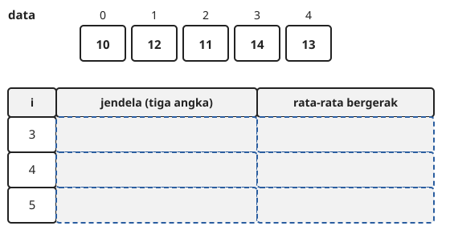

**Ingat dulu:** Tanpa melihat catatan, jawab. (1) Mengapa rata-rata bisa menyesatkan, dan apa pelengkapnya? (2) Bagaimana menghitung rata-rata dari daftar angka dengan perulangan, tanpa fungsi siap pakai? (3) Apa itu galat (MAE atau RMSE) dan bagaimana menghitungnya dari selisih? ______



`[Gambar: lima sel berisi 10, 12, 11, 14, 13 dengan indeks 0 sampai 4 di atasnya. Di bawahnya tabel kosong untuk posisi i = 3, 4, 5 dengan kolom jendela (tiga angka) dan rata-rata bergerak.]`

**Prediksi:** Tebak dan tulis dua keluaran, baru jalankan.

```python
data = [10, 12, 11, 14]
print(round(sum(data[-3:]) / 3, 2))
print(data[-1] - data[0])
```

Keluaran: ______ , ______. Bila deretan angkanya terus naik, apakah rata-rata tiga angka terakhir cenderung di atas atau di bawah angka berikutnya yang sebenarnya? ______

**Lengkapi:** Isi bagian `____` supaya program mencetak rata-rata bergerak tiga angka pada tiap posisi, dibulatkan dua desimal. Jangan memakai `rolling`; pakai perulangan.

```python setengah-jadi
data = [10, 12, 11, 14, 13]
k = 3
for i in range(k, len(data) + 1):
    jendela = data[i - ____ : i]
    print(i, round(sum(jendela) / ____, 2))
```

Isi tabel pada gambar dengan hasil penelusuranmu.

**Susun:** Susun baris menjadi program yang mencocokkan garis lurus pada lima titik lalu mencetak tebakan untuk x = 6, dibulatkan satu desimal. Lekukan tidak dipakai; yang diacak hanya urutannya.

```text
A. print(round(a * 6 + b, 1))
B. import numpy as np
C. y = [2, 4, 6, 8, 10]
D. a, b = np.polyfit(x, y, 1)
E. x = [1, 2, 3, 4, 5]
```

Urutan: ____ , ____ , ____ , ____ , ____

**Latihan:**

1. (`AI: tanpa AI`) Untuk data `[4, 6, 5, 9]`, tulis tebakan rata-rata bergerak tiga angka untuk titik berikutnya. Lalu, bila kenyataan dua titik berikutnya `[6, 9]` dan tebakannya `[5, 7]`, hitung MAE. ______________________________
2. (`AI: tanpa AI`) Tulis pseudocode untuk membagi data berurutan menjadi bagian latih (angka awal) dan bagian uji (angka akhir), lalu tulis programnya. Mengapa data berurutan waktu tidak diacak sebelum dibagi? ______________________________
3. (`AI: boleh`) Seorang murid mencocokkan garis pada minggu 1 sampai 9, lalu menghitung MAE pada minggu 1 sampai 9 juga, mendapat angka yang sangat kecil, dan menyimpulkan modelnya hebat. Apa yang keliru dan bagaimana memperbaikinya? ______________________________

**Cek diri:**

- [ ] Saya dapat menghitung rata-rata bergerak dengan tangan dan dengan perulangan.
- [ ] Saya menghitung MAE pada data yang tidak dipakai menyusun tebakan.
- [ ] Saya menulis pembanding sederhana sebelum mencoba cara yang lebih rumit.

**Catatan cetak (untuk guru, tidak dicetak):** satu lembar A4, satu halaman. Kunci ada di modul `d-xi1-m8`, bagian "Kunci dan petunjuk". Lembar tidak memuat kolom nama, kelas, tanggal, atau nilai.
