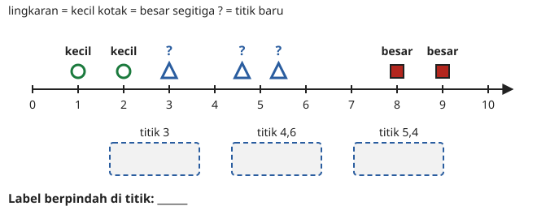

**Ingat dulu:** Tanpa melihat catatan, jawab. (1) Mengapa rencana evaluasi menulis pembanding sederhana, misalnya tebakan mayoritas? (2) Mengapa galat prediksi dihitung pada data yang tidak dipakai menyusun prediksinya? (3) Bagaimana kNN menebak label sebuah titik baru? ______



`[Gambar: garis bilangan 0 sampai 10. Titik latih 1 dan 2 berlabel kecil, titik latih 8 dan 9 berlabel besar. Tiga tanda tanya di 3, 4,6, dan 5,4 dengan kotak kosong di bawahnya untuk menulis label tebakan, dan satu baris kosong untuk menulis titik perpindahan label.]`

**Prediksi:** Tebak dan tulis keluarannya, baru jalankan. Titik baru yang ditebak adalah 3, 4,6, dan 5,4.

```python
from sklearn.neighbors import KNeighborsClassifier

X = [[1], [2], [8], [9]]
y = ["kecil", "kecil", "besar", "besar"]
model = KNeighborsClassifier(n_neighbors=1).fit(X, y)
print(model.predict([[3], [4.6], [5.4]]))
```

Keluaran: ______________________________ Pada titik berapa tebakannya berpindah dari satu label ke label lain, dan mengapa `X` ditulis sebagai daftar berisi daftar kecil, bukan daftar angka biasa? ______________________________

**Lengkapi:** Isi bagian `____` supaya program melatih penggolong satu tetangga, menebak dua titik baru, dan mencetak ketepatannya.

```python setengah-jadi
from sklearn.neighbors import KNeighborsClassifier

X_latih = [[1, 1], [2, 1], [8, 9], [9, 8]]
y_latih = ["A", "A", "B", "B"]
model = KNeighborsClassifier(n_neighbors=____)
model.____(X_latih, y_latih)
print(model.____([[2, 2], [8, 8]]))
print(model.score([[2, 2], [8, 8]], ["A", "B"]))
```

**Susun:** Susun baris menjadi program yang melatih penggolong satu tetangga lalu mencetak tebakan untuk titik 9. Lekukan tidak dipakai; yang diacak hanya urutannya.

```text
A. print(model.predict([[9]]))
B. y = [0, 0, 1, 1]
C. from sklearn.neighbors import KNeighborsClassifier
D. model.fit(X, y)
E. X = [[0], [1], [10], [11]]
F. model = KNeighborsClassifier(n_neighbors=1)
```

Urutan: ____ , ____ , ____ , ____ , ____ , ____

**Latihan:**

1. (`AI: tanpa AI`) Tetangga terdekat dengan k = 3. Data `X = [[1], [2], [3], [10], [11]]`, label `a, a, a, b, b`. Tebak label titik 6: tulis jarak ke kelima titik, tiga yang terdekat, dan hasil pemungutan suaranya. ______________________________
2. (`AI: tanpa AI`) Tulis pseudocode tujuh langkah dari tabel sampai tebakan (siapkan tabel, pisahkan `X` dan `y`, bagi latih dan uji, pembanding mayoritas, latih, nilai, tebak). Mengapa pembanding mayoritas dijalankan sebelum model? ______________________________
3. (`AI: boleh`) Tulis fungsi pembangkit sendiri untuk dua kelas dengan sedikitnya 30 baris (aturan tampak di kode, tanpa data orang). Jalankan pembanding dan satu model, lalu tulis ketepatan keduanya. ______________________________

**Cek diri:**

- [ ] Saya dapat memakai `fit`, `predict`, dan `score` dan menjelaskan fungsi masing-masing.
- [ ] Saya menjalankan pembanding mayoritas sebelum model.
- [ ] Saya menyebut batas kesimpulan dari data uji yang kecil.

**Catatan cetak (untuk guru, tidak dicetak):** satu lembar A4, satu halaman. Kunci ada di modul `d-xi1-m9`, bagian "Kunci dan petunjuk". Lembar tidak memuat kolom nama, kelas, tanggal, atau nilai.
