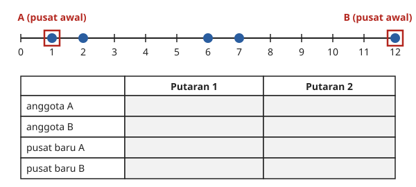

**Ingat dulu:** Jawab tanpa melihat catatan.

1. Sebutkan langkah k-means: pusat awal, penetapan, pusat baru, dan kapan berhenti. ______
2. Mengapa pengubahan skala dipasang pada data latih saja? ______
3. Mengapa sumbu grafik batang harus mulai dari nol? ______



`[Gambar: garis bilangan 0 sampai 12 dengan titik pada 1, 2, 6, 7, dan 12. Titik 1 (A) dan titik 12 (B) adalah pusat awal. Di bawahnya tabel kosong: untuk putaran 1 dan putaran 2, tulis anggota A, anggota B, pusat baru A, dan pusat baru B.]`

**Prediksi:** Tebak dan tulis keluarannya, baru jalankan.

```python
from sklearn.cluster import KMeans

X = [[1], [2], [9], [11]]
model = KMeans(n_clusters=2, n_init=10, random_state=0).fit(X)
print(sorted(model.cluster_centers_.ravel().round(1).tolist()))
print(len(set(model.labels_)))
```

Keluaran baris 1: ______  Keluaran baris 2: ______

Mengapa `fit(X)` tidak punya kolom jawaban `y`? ______

**Lengkapi:** Isi bagian `____` supaya program membuat dua kelompok dari empat titik, mencetak pusatnya, dan menempatkan dua titik baru.

```python setengah-jadi
from sklearn.cluster import KMeans

X = [[1, 1], [2, 1], [8, 9], [9, 8]]
model = KMeans(n_clusters=____, n_init=10, random_state=0)
model.____(X)
print(sorted(model.cluster_centers_.tolist()))
baru = model.____([[2, 2], [8, 8]])
print(baru[0] == model.labels_[0], baru[1] == model.labels_[2])
```

**Susun:** Urutkan baris berikut menjadi program yang mengelompokkan lima titik menjadi dua kelompok lalu mencetak pusatnya dari yang terkecil.

- A. `print(sorted(model.cluster_centers_.ravel().tolist()))`
- B. `model = KMeans(n_clusters=2, n_init=10, random_state=0)`
- C. `X = [[1], [2], [9], [10], [11]]`
- D. `model.fit(X)`
- E. `from sklearn.cluster import KMeans`

Urutan: ___ → ___ → ___ → ___ → ___

**Latihan:**

1. (`AI: tanpa AI`) Titik satu dimensi 1, 2, 6, 7, 12 dengan k = 2 dan pusat awal 1 dan 12. Isi tabel pada gambar: penetapan tiap titik, pusat baru, putaran berikutnya, dan tulis kapan berhenti. ______
2. (`AI: tanpa AI`) Mengapa `n_init=10` dipakai dan bukan satu kali jalan? ______
3. (`AI: boleh`) Pada tabel ringkasan kelompok pelanggan kios (kunjungan dan belanja), beri tiap kelompok nama pendek dan tulis dua hal yang **tidak boleh** disimpulkan.

| Kelompok | Jumlah | Rata-rata kunjungan | Rata-rata belanja (ribu) | Nama pendek |
| --- | --- | --- | --- | --- |
| 0 | 10 | 9,3 | 135,9 | |
| 1 | 10 | 4,5 | 58,3 | |
| 2 | 10 | 16,5 | 87,4 | |

Dua hal yang tidak boleh disimpulkan: ______

**Cek diri:**

- [ ] Saya dapat menyebut tiga langkah k-means dan kapan ia berhenti.
- [ ] Saya dapat menjelaskan mengapa data diubah skalanya sebelum dikelompokkan.
- [ ] Saya dapat memilih k dengan siluet dan menyebut batasnya.

**Catatan cetak (untuk guru, tidak dicetak):** satu lembar, dua halaman A4. Kunci ada di modul `d-xi2-m1` bagian "Kunci dan petunjuk". Lembar tidak memuat kolom nama, kelas, tanggal, atau nilai.
