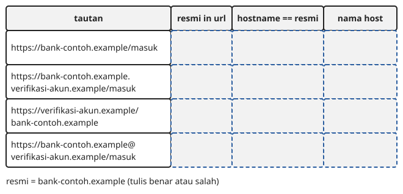

**Ingat dulu:** Tanpa melihat catatan, jawab. (1) Apa beda AI sebagai subjek yang dipelajari dan AI sebagai alat menulis kode? (2) Apa pertanyaan yang diajukan sebelum mempercayai sebuah penjelasan model? ______



`[Gambar: tabel empat tautan karangan: bank-contoh.example/masuk, bank-contoh.example.verifikasi-akun.example/masuk, verifikasi-akun.example/bank-contoh.example, dan bank-contoh.example@verifikasi-akun.example/masuk, semuanya berawalan https. Dua kolom kosong untuk hasil "resmi in url" dan hasil "hostname sama dengan resmi" (benar atau salah), serta satu kolom kosong untuk nama host tiap tautan.]`

**Prediksi:** Alamat resmi sebuah bank karangan adalah `bank-contoh.example`. Dua cara memeriksa tautan: `resmi in url` (nama resmi muncul di mana saja) dan `urlparse(url).hostname == resmi` (hanya nama host yang dibandingkan). Tebak dan tulis, untuk tiap tautan pada gambar, hasil kedua cara itu sebelum menjalankan.

```python
from urllib.parse import urlparse

resmi = "bank-contoh.example"
tautan = [
    "https://bank-contoh.example/masuk",
    "https://bank-contoh.example.verifikasi-akun.example/masuk",
    "https://verifikasi-akun.example/bank-contoh.example",
    "https://bank-contoh.example@verifikasi-akun.example/masuk",
]
for url in tautan:
    print(resmi in url, urlparse(url).hostname == resmi, url)
```

**Lengkapi:** Isi `____` agar fungsi menerima alamat resmi dan subdomainnya, dan menolak alamat yang hanya memuat nama resmi di tengah.

```python setengah-jadi
from urllib.parse import urlparse


def alamat_sah(url, resmi):
    host = urlparse(url).____ or ""
    return host == ____ or host.endswith("." + ____)


print(alamat_sah("https://layanan.perpus-contoh.example/masuk", "perpus-contoh.example"))
print(alamat_sah("https://perpus-contoh.example.cek.example/masuk", "perpus-contoh.example"))
```

**Susun:** Susun baris menjadi fungsi yang mengembalikan daftar kata desakan yang ada di sebuah pesan, lalu mencetak hasilnya untuk satu pesan.

```text
A. print(tanda_desakan("Akun diblokir, segera bayar"))
B.     return [k for k in kata if k in kecil]
C. def tanda_desakan(pesan):
D.     kata = ("segera", "diblokir", "hari ini")
E.     kecil = pesan.lower()
```

Urutan: ____ , ____ , ____ , ____ , ____

**Latihan:**

1. (`AI: tanpa AI`) Pesan karangan: "Selamat, Anda terpilih menerima hadiah! Klaim dalam 1 jam lewat `https://hadiah-contoh.example.klaim.example/ambil`." Isi lembar periksa: apa yang ditanyakan, bagaimana memeriksa, dan putusanmu (percaya, tahan, atau laporkan). ______________________________
2. (`AI: tanpa AI`) Sebuah unggahan karangan menyebut "banjir di Kota Contoh tadi pagi" lewat gambar tanpa keterangan sumber. Pencarian asal gambar menemukan kemunculan paling awalnya tiga tahun lalu dengan keterangan "Kota Lain". Tulis status klaim (didukung, bertentangan, atau tidak ditemukan), apakah gambar itu buatan AI, dan langkah berikutnya. ______________________________
3. (`AI: boleh`) Tulis satu skenario karangan pesan suara dari "kepala sekolah" fiktif yang meminta transfer mendesak, lalu tulis tiga langkah memverifikasinya tanpa membalas pesan itu. Jangan memakai suara atau nama orang nyata. ______________________________

**Cek diri:**

- [ ] Saya dapat memeriksa nama host sebuah tautan dengan program.
- [ ] Saya dapat menjelaskan positif palsu dan negatif palsu pada alat pemeriksa.
- [ ] Saya dapat memutuskan percaya, tahan, atau laporkan, dengan alasan.

**Catatan cetak (untuk guru, tidak dicetak):** satu lembar A4, satu halaman. Kunci ada di modul `d-xi2-m10`, bagian "Kunci dan petunjuk" dan "Contoh terselesaikan". Lembar tidak memuat kolom nama, kelas, tanggal, atau nilai.
