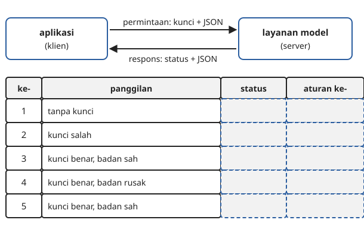

**Ingat dulu:** Tanpa melihat catatan, jawab. (1) Mengapa alat pemeriksa otomatis memberi petunjuk, bukan putusan? (2) Mengapa jaringan yang sudah dilatih harus disimpan bersama pengubah skalanya, dan apa yang terjadi bila skalanya tertinggal? (3) Beri satu contoh fitur turunan dan jelaskan mengapa ia bisa membantu model sederhana. ______



`[Gambar: di atas, kotak aplikasi (klien) dan kotak layanan model (server) dengan anak panah permintaan ke kanan dan anak panah respons ke kiri. Di bawahnya tabel lima panggilan: (1) tanpa kunci, (2) kunci salah, (3) kunci benar dengan badan sah, (4) kunci benar dengan badan rusak, (5) kunci benar dengan badan sah. Kolom status dan kolom aturan yang dipakai kosong.]`

**Prediksi:** Layanan tiruan memakai aturan berikut, diperiksa **berurutan**: tanpa kunci jawabannya 401; kunci salah 403; bila ini panggilan ke-5 atau lebih (berapa pun hasil panggilan sebelumnya) 429; badan JSON rusak 400; selain itu 200. Lima panggilan dikirim berturut-turut seperti pada gambar. Tebak dan tulis status kelimanya pada tabel di gambar.

**Lengkapi:** Isi `____` agar fungsi mencoba memanggil sebanyak-banyaknya `maksimal` kali, berhenti saat statusnya 200, dan mengembalikan `None` bila tidak pernah berhasil.

```python setengah-jadi
def coba_lagi(panggil, maksimal):
    for ke in range(1, ____ + 1):
        status = panggil(ke)
        if status == ____:
            return ke
    return ____


print(coba_lagi(lambda ke: 429 if ke < 3 else 200, 5))
print(coba_lagi(lambda ke: 429, 2))
```

**Susun:** Susun baris menjadi fungsi yang menyalin header dan mengganti kuncinya dengan `***` sebelum dicetak. Lekukan sudah dipakai; yang diacak hanya urutannya.

```text
A.     return salinan
B. def aman_dicetak(header):
C.     if "Authorization" in salinan:
D.     salinan = dict(header)
E.         salinan["Authorization"] = "***"
```

Urutan: ____ , ____ , ____ , ____ , ____

**Latihan:**

1. (`AI: tanpa AI`) Dengan layanan tiruan yang sama, tulis status enam panggilan berturut-turut yang semuanya memakai kunci benar dan badan sah. Lalu tulis status panggilan ke-5 bila kuncinya tidak dikirim. ______________________________
2. (`AI: tanpa AI`) Gambar di kertas alur permintaan aplikasi karanganmu ke layanan model: kotak klien, jaringan, server, dan model; beri label data yang keluar, tempat kunci disimpan, dan status yang mungkin kembali. ______________________________
3. (`AI: tanpa AI`) Kunci layanan tiruan terlanjur ada di berkas yang diunggah ke repositori publik. Urutkan lima langkah penanganan dan beri alasannya. ______________________________

**Cek diri:**

- [ ] Saya dapat membaca status 200, 400, 401, 403, dan 429.
- [ ] Saya dapat memakai kunci tanpa menulisnya di kode atau log.
- [ ] Saya dapat menyebut data yang keluar dan risikonya.

**Catatan cetak (untuk guru, tidak dicetak):** satu lembar A4, satu halaman. Kunci ada di modul `d-xi2-m11`, bagian "Kunci dan petunjuk". Lembar tidak memuat kolom nama, kelas, tanggal, atau nilai.
