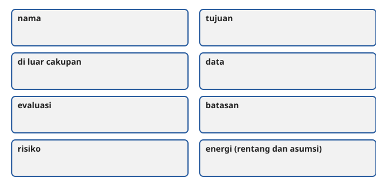

**Ingat dulu:** Jawab tanpa melihat catatan.

1. Mengapa kunci layanan disimpan di variabel lingkungan atau penyimpan rahasia, bukan di dalam kode? ______
2. Mengapa vektorizer dipasang pada data latih saja, dan apa yang terjadi pada kata baru di data uji? ______
3. Sebutkan dua batas penjelasan fitur penting yang layak ditulis di kartu model. ______



`[Gambar: kartu model berisi delapan kotak kosong berlabel: nama, tujuan, di luar cakupan, data, evaluasi, batasan, risiko, dan energi (rentang dan asumsi). Dipakai di Latihan 2.]`

**Prediksi:** Energi dalam watt-jam (Wh) adalah daya (W) kali waktu (jam). Pelatihan memakan 2,0 detik pada komputer yang diasumsikan berdaya 15 sampai 65 W. Tebak dan tulis, sebelum menjalankan: rentang energinya dalam Wh (empat desimal), dan rentang untuk 100 kali percobaan (dua desimal).

```python
def rentang_energi(daya_rendah, daya_tinggi, detik):
    return daya_rendah * detik / 3600, daya_tinggi * detik / 3600


rendah, tinggi = rentang_energi(15, 65, 2.0)
print(round(rendah, 4), round(tinggi, 4))
print(round(rendah * 100, 2), round(tinggi * 100, 2))
```

Satu percobaan: ______ sampai ______ Wh  Seratus percobaan: ______ sampai ______ Wh

**Lengkapi:** Isi bagian `____` agar fungsi menghitung seluruh parameter jaringan (bobot dan bias) dari atribut model terlatih.

```python setengah-jadi
def jumlah_parameter(model):
    return sum(w.____ for w in model.coefs_) + sum(b.size for b in model.____)
```

**Susun:** Urutkan baris berikut menjadi fungsi yang mencetak tiap bagian kartu, dan "tidak diketahui" untuk bagian yang tidak diisi. Lekukan sudah dipakai.

```text
A.         nilai = kartu.get(kunci, "tidak diketahui")
B. def cetak_kartu(kartu, urutan):
C.         print(kunci + ":", nilai)
D.     for kunci in urutan:
```

Urutan: ___ → ___ → ___ → ___

**Latihan:**

1. (`AI: tanpa AI`) Pelatihan 12 detik pada komputer berdaya 20 sampai 50 W. Hitung rentang energinya dalam Wh dan untuk 30 percobaan. Tulis satu hal yang tidak termasuk dalam angkamu. ______
2. (`AI: tanpa AI`) Untuk kartu penggolong kolam, isi bagian "di luar cakupan" dan "batasan" pada gambar: dua hal di luar cakupan dan dua batasan, masing-masing dengan alasan.
3. (`AI: boleh`) Ukur waktu pelatihan modelmu tiga kali dengan `time.perf_counter()`, laporkan rentangnya, jelaskan mengapa angkanya berbeda, dan hitung ulang rentang energinya. ______

**Cek diri:**

- [ ] Saya dapat menyusun kartu model lengkap dengan batasan dan risiko.
- [ ] Saya dapat menghitung rentang energi dari daya dan waktu, dengan asumsi.
- [ ] Saya dapat menulis "tidak diketahui" dengan alasan.

**Catatan cetak (untuk guru, tidak dicetak):** satu lembar, dua halaman A4. Kunci ada di modul `d-xi2-m12` bagian "Kunci dan petunjuk". Lembar tidak memuat kolom nama, kelas, tanggal, atau nilai.
