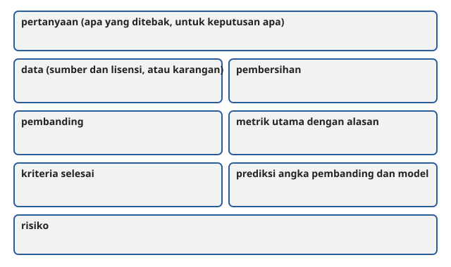

**Ingat dulu:** Jawab tanpa melihat catatan.

1. Mengapa kata yang paling mendorong tebakan hanya menunjukkan pola, bukan sebab? ______
2. Apa saja bagian kartu model, dan baris mana yang menyatakan ketidakpastian? ______
3. Apa tiga status klaim di lembar periksa, dan apa yang dilakukan bila klaim belum bisa dipastikan? ______

`[Gambar: formulir rencana proyek dengan delapan kotak kosong berlabel: pertanyaan, data, pembersihan, pembanding, metrik utama dengan alasan, kriteria selesai, prediksi angka pembanding dan model, dan risiko. Isi untuk proyek miniku.]`

**Lengkapi:** Tulis rencana **sebelum** kode. Isi delapan kotak pada gambar untuk proyek miniku: pertanyaan (apa yang ditebak, untuk keputusan apa), data (sumber dan lisensi, atau pembangkit "karangan"), pembersihan, pembanding, metrik utama dengan alasan, kriteria selesai, prediksi angka pembanding dan model, dan risiko.

**Latihan:**

1. (`AI: tanpa AI`) Kerangka proyek menaruh `SimpleImputer` dan `StandardScaler` di dalam `make_pipeline`. Apa yang berubah bila keduanya dipasang pada seluruh `X` sebelum `cross_validate`? ______
2. (`AI: tanpa AI`) Pada keluaran importansi permutasi kerangka, kolom `jam` paling tinggi (0,217 dengan sebaran 0,027), disusul `getaran` (0,118) dan `suhu` (0,116). Tulis satu kalimat yang boleh dan satu yang tidak boleh disimpulkan. ______
3. (`AI: boleh`) Tukar proyek dengan kelompok lain dan beri umpan balik dalam tiga kalimat: satu yang sudah baik, satu yang perlu diperbaiki, satu langkah berikutnya, masing-masing menunjuk bagian tertentu (baris kode, angka, atau baris kartu). Pakai nama kelompok atau nomor, bukan nama orang.

Baik: ______

Perlu diperbaiki: ______

Langkah berikutnya: ______

**Cek diri:**

- [ ] Saya menulis rencana dan prediksi sebelum mengerjakan.
- [ ] Saya membandingkan model dengan pembanding pada lipatan yang sama, tanpa kebocoran.
- [ ] Saya menulis kartu model dengan baris biaya komputasi dan energi.

**Catatan cetak (untuk guru, tidak dicetak):** satu lembar, dua halaman A4. Bagian Prediksi, Susun, dan Lengkapi kode dilewati karena modul ini berbentuk proyek tanpa soal semacam itu. Kunci ada di modul `d-xi2-m13` bagian "Kunci dan petunjuk". Lembar tidak memuat kolom nama, kelas, tanggal, atau nilai.
