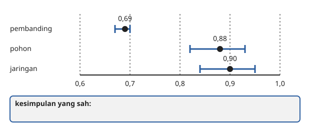

**Ingat dulu:** Jawab dari ingatan, di kertas. Yang masih lupa dicatat untuk diulang, bukan dihukum.

1. Mengapa selisih ketepatan yang lebih kecil daripada sebaran antar lipatan belum membuktikan satu model lebih baik? ______
2. Mengapa alat pemeriksa otomatis memberi petunjuk, bukan putusan? ______
3. Urutkan isi proyek model dari pertanyaan sampai kartu model. ______



`[Gambar: sumbu ketepatan 0,6 sampai 1,0. Pembanding 0,69 (sebaran 0,67 sampai 0,70), pohon 0,88 (0,82 sampai 0,93), jaringan 0,90 (0,84 sampai 0,95). Di bawah, kotak kosong untuk kesimpulan yang sah. Dipakai di Latihan 2.]`

**Prediksi:** Tulis keluaran program di kertas, baru jalankan.

```python
x = [2, -1, 3]
w = [0.5, 1.0, -0.2]
b = 0.4
z = sum(xi * wi for xi, wi in zip(x, w)) + b
print(round(z, 2), max(0, round(z, 2)))
```

Keluaran: ______

Jumlah parameter jaringan dengan 3 masukan, satu lapis tersembunyi berisi 5 neuron, dan 1 keluaran: ______

**Latihan:** (kerjakan tanpa AI)

1. Hasil lima lipatan pada 120 baris data karangan ada pada gambar. Tulis satu kesimpulan yang sah dan dua yang tidak sah, dan apa yang akan menambah keyakinanmu. ______
2. Seorang siswa fiktif memasang `StandardScaler` pada seluruh data sebelum validasi silang, melaporkan ketepatan jaringan 0,99, dan menulis kartu model yang hanya memuat angka itu. Sebutkan empat kelemahan dan perbaikan masing-masing. ______
3. Pesan karangan: "Segera kirim kode OTP ke `https://bantuan-contoh.example.cek.example`." Sebutkan tiga tanda dan tindakanmu. ______
4. Sebuah program menulis kunci layanan langsung di kode. Apa yang diubah, dan apa yang dilakukan bila kode itu sudah terunggah? ______

**Cek diri:**

- [ ] Saya menelusuri program di kertas sebelum menjalankannya.
- [ ] Saya dapat membaca tabel evaluasi dan menyebut kesimpulan yang sah.
- [ ] Saya dapat mengenali dan memperbaiki kebocoran data.

**Catatan cetak (untuk guru, tidak dicetak):** satu lembar, dua halaman A4. Bagian Lengkapi dan Susun dilewati karena modul ulasan ini tidak memuatnya. Kunci ada di modul `d-xi2-m14` bagian "Kunci dan petunjuk". Lembar tidak memuat kolom nama, kelas, tanggal, atau nilai.
