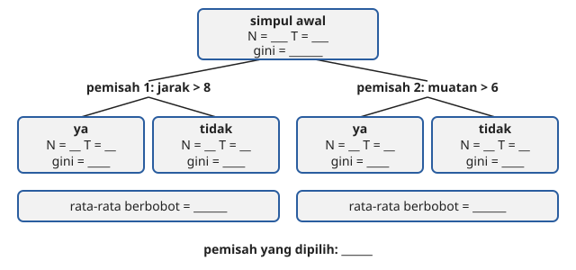

**Ingat dulu:** Jawab tanpa melihat catatan.

1. Mengapa rata-rata bergerak tertinggal pada data yang terus naik? ______
2. Mengapa nama kelompok hasil k-means, misalnya "pelanggan setia", tidak membuktikan jenis yang sebenarnya? ______
3. Bagaimana pohon keputusan menebak label sebuah contoh baru? ______



`[Gambar: kotak simpul awal dengan isian N, T, dan gini. Dari situ dua pemisah, "jarak > 8" dan "muatan > 6". Tiap pemisah punya kotak ya dan tidak dengan isian N, T, gini, lalu isian rata-rata berbobot. Di bawah, isian pemisah yang dipilih.]`

**Prediksi:** Tebak dan tulis keluarannya, baru jalankan. Pohon satu tingkat ini dilatih pada enam titik satu dimensi.

```python
from sklearn.tree import DecisionTreeClassifier, export_text

X = [[1], [2], [3], [10], [11], [12]]
y = [0, 0, 0, 1, 1, 1]
pohon = DecisionTreeClassifier(max_depth=1, random_state=0).fit(X, y)
print(export_text(pohon, feature_names=["x"]))
print(pohon.predict([[5], [7]]))
```

Di nilai berapa pohon memotong, dan dari mana angkanya? ______

Keluaran `predict`: ______

**Lengkapi:** Isi bagian `____` supaya program melatih hutan 20 pohon, menebak dua titik, dan mencetak jumlah pohon.

```python setengah-jadi
from sklearn.ensemble import RandomForestClassifier

X = [[1, 1], [2, 2], [3, 1], [8, 9], [9, 8], [10, 10]]
y = [0, 0, 0, 1, 1, 1]
hutan = RandomForestClassifier(n_estimators=____, random_state=0)
hutan.____(X, y)
print(hutan.predict([[2, 1], [9, 9]]))
print(len(hutan.____))
```

**Susun:** Urutkan baris berikut menjadi program yang melatih pohon satu tingkat lalu menebak titik 9.

- A. `print(pohon.predict([[9]]))`
- B. `pohon.fit(X, y)`
- C. `y = [0, 0, 1, 1]`
- D. `from sklearn.tree import DecisionTreeClassifier`
- E. `X = [[0], [1], [10], [11]]`
- F. `pohon = DecisionTreeClassifier(max_depth=1, random_state=0)`

Urutan: ___ → ___ → ___ → ___ → ___ → ___

**Latihan:**

1. (`AI: tanpa AI`) Delapan pengiriman karangan, status N atau T. Hitung gini simpul awal, lalu rata-rata berbobot untuk pemisah "jarak lebih dari 8" dan "muatan lebih dari 6" pada gambar. Mana yang dipilih?

| Jarak (km) | 4 | 6 | 7 | 9 | 12 | 13 | 16 | 5 |
| --- | --- | --- | --- | --- | --- | --- | --- | --- |
| Muatan (kg) | 3 | 9 | 2 | 8 | 4 | 9 | 3 | 7 |
| Status | N | N | N | T | T | T | T | T |

2. (`AI: tanpa AI`) Tulis daftar hal yang harus sama agar pohon kedalaman 1 sampai 6 dibandingkan secara adil. ______
3. (`AI: boleh`) Jalankan hutan dengan `n_estimators` 10, 50, dan 200 pada validasi silang yang sama dan tulis apa yang kamu lihat. ______

**Cek diri:**

- [ ] Saya dapat menghitung gini sebuah simpul dan membandingkan dua pemisah.
- [ ] Saya dapat menunjukkan kelebihan-suai dari selisih ketepatan latih dan uji.
- [ ] Saya dapat menjelaskan apa yang dilakukan hutan acak.

**Catatan cetak (untuk guru, tidak dicetak):** satu lembar, dua halaman A4. Kunci ada di modul `d-xi2-m2` bagian "Kunci dan petunjuk". Lembar tidak memuat kolom nama, kelas, tanggal, atau nilai.
