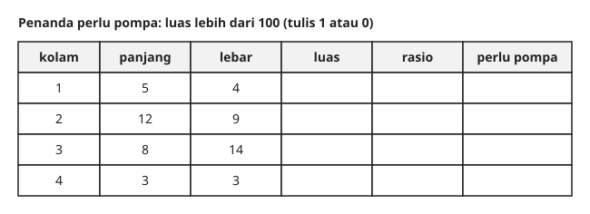

**Ingat dulu:** Jawab tanpa melihat catatan.

1. Apa urutan memakai model `scikit-learn`: bentuk `X` dan `y`, `fit`, `predict`, lalu menilai? ______
2. Bagaimana validasi silang lima lipatan bekerja? ______
3. Mengapa pembanding mayoritas dijalankan sebelum model? ______



`[Gambar: tabel empat kolam dengan panjang dan lebar (5 dan 4, 12 dan 9, 8 dan 14, 3 dan 3). Kolom luas, rasio, dan perlu pompa kosong; isi sebagai jawaban soal Latihan 1.]`

**Prediksi:** Tebak dan tulis keluarannya, baru jalankan: nama kolom, dan isi tiap baris.

```python
import pandas as pd

df = pd.DataFrame({"panjang": [4, 10], "lebar": [3, 12], "air": ["tawar", "payau"]})
df["luas"] = df["panjang"] * df["lebar"]
print(pd.get_dummies(df, columns=["air"], dtype=int))
```

Nama kolom: ______

Baris 0: ______  Baris 1: ______

Mengapa kolom `air` diganti dua kolom angka? ______

**Lengkapi:** Isi bagian `____` supaya program membuat kolom kecepatan dan penanda "cepat" bila kecepatan melebihi 6.

```python setengah-jadi
import pandas as pd

df = pd.DataFrame({"jarak": [10, 20, 30], "waktu": [2, 5, 3]})
df["kecepatan"] = df["____"] / df["____"]
df["cepat"] = (df["kecepatan"] > ____).astype(int)
print(df)
```

**Susun:** Urutkan baris berikut menjadi program yang menilai pipeline dengan validasi silang tiga lipatan.

- A. `print(cross_val_score(model, X, y, cv=3).round(2))`
- B. `from sklearn.pipeline import make_pipeline`
- C. `y = [0, 0, 0, 1, 1, 1]`
- D. `from sklearn.model_selection import cross_val_score`
- E. `model = make_pipeline(StandardScaler(), LogisticRegression())`
- F. `from sklearn.preprocessing import StandardScaler`
- G. `X = [[1, 2], [2, 1], [3, 3], [8, 9], [9, 8], [10, 10]]`
- H. `from sklearn.linear_model import LogisticRegression`

Urutan: ___ → ___ → ___ → ___ → ___ → ___ → ___ → ___

**Latihan:**

1. (`AI: tanpa AI`) Isi tabel pada gambar: `luas`, `rasio` panjang per lebar (dua desimal), dan penanda "perlu pompa" (luas lebih dari 100).
2. (`AI: tanpa AI`) Mengapa `StandardScaler` ditaruh di dalam `Pipeline`? ______
3. (`AI: boleh`) Ulangi percobaan seleksi fitur dengan `k` 10 dan 20. Apa yang terjadi pada angka "sebelum membagi" dan pada angka di dalam `Pipeline`? ______

**Cek diri:**

- [ ] Saya dapat membuat fitur turunan dari kolom yang ada.
- [ ] Saya dapat mengubah kolom kategori menjadi kolom 0 atau 1.
- [ ] Saya dapat menjelaskan kebocoran pada pemilihan fitur.

**Catatan cetak (untuk guru, tidak dicetak):** satu lembar, dua halaman A4. Kunci ada di modul `d-xi2-m3` bagian "Kunci dan petunjuk". Lembar tidak memuat kolom nama, kelas, tanggal, atau nilai.
