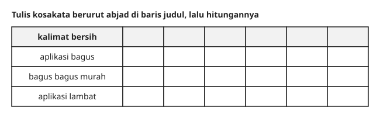

**Ingat dulu:** Jawab tanpa melihat catatan.

1. Mengapa ketepatan saja tidak cukup pada data yang timpang, dan metrik apa yang melengkapinya? ______
2. Mengapa memilih fitur memakai seluruh data sebelum membagi menghasilkan ketepatan yang terlalu bagus? ______
3. Mengapa fitur dengan angka besar bisa menguasai jarak, dan bagaimana mengatasinya? ______



`[Gambar: tabel dengan tiga baris kalimat bersih (aplikasi bagus; bagus bagus murah; aplikasi lambat) dan enam kolom kosong. Tulis kosakata berurut abjad di baris judul, lalu hitungan tiap kata. Dipakai di Latihan 2.]`

**Prediksi:** Tebak dan tulis keluarannya, baru jalankan: daftar kata (dalam urutan apa), lalu isi matriks.

```python
from sklearn.feature_extraction.text import CountVectorizer

cv = CountVectorizer()
M = cv.fit_transform(["Saya suka suka kopi", "Kopi saya dingin"])
print(list(cv.get_feature_names_out()))
print(M.toarray())
```

Daftar kata: ______

Matriks: ______

Apakah huruf besar pada "Saya" dan "Kopi" menambah kata baru? ______

**Lengkapi:** Isi bagian `____` supaya program menghitung kata pada dua kalimat dan mencetak kolom dan barisnya.

```python setengah-jadi
from sklearn.feature_extraction.text import CountVectorizer

cv = CountVectorizer()
M = cv.____(["kopi panas panas", "kopi dingin"])
print(list(cv.get_feature_names_out()))
print(M.____())
print(M.toarray()[0][list(cv.get_feature_names_out()).index("____")])
```

**Susun:** Urutkan baris berikut menjadi program yang memasang vektorizer pada kalimat latih lalu mengubah satu kalimat uji menjadi baris angka.

- A. `print(cv.transform(uji).toarray())`
- B. `uji = ["kopi panas"]`
- C. `cv = CountVectorizer().fit(latih)`
- D. `latih = ["kopi panas panas", "teh dingin"]`
- E. `from sklearn.feature_extraction.text import CountVectorizer`

Urutan: ___ → ___ → ___ → ___ → ___

**Latihan:**

1. (`AI: tanpa AI`) Dengan kata henti {dan, sekali}, tulis daftar kata hasil pembersihan (huruf kecil, buang tanda baca dan angka, pecah menjadi kata, buang kata henti) untuk "Layanan, CEPAT sekali!!! Harga 5 ribu." ______
2. (`AI: tanpa AI`) Kalimat bersih: "aplikasi bagus", "bagus bagus murah", "aplikasi lambat". Tulis kosakata berurut abjad dan matriks hitungannya pada gambar.
3. (`AI: boleh`) Masukkan "tidak" ke daftar kata henti. Apa yang terjadi pada kalimat yang memuatnya, dan mengapa itu berbahaya untuk klasifikasi? ______

**Cek diri:**

- [ ] Saya dapat membuat dan membaca matriks hitungan kata.
- [ ] Saya dapat menjelaskan beda hitungan kata dan TF-IDF.
- [ ] Saya memasang vektorizer hanya pada data latih.

**Catatan cetak (untuk guru, tidak dicetak):** satu lembar, dua halaman A4. Kunci ada di modul `d-xi2-m4` bagian "Kunci dan petunjuk". Lembar tidak memuat kolom nama, kelas, tanggal, atau nilai.
