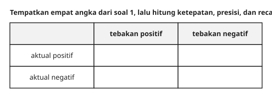

**Ingat dulu:** Jawab tanpa melihat catatan.

1. Apa saja yang harus sama agar dua model dibandingkan secara adil? ______
2. Mengapa kata seperti "tidak" tidak boleh sembarang masuk daftar kata henti? ______
3. Mengapa model tidak boleh dinilai pada data latih, dan bagaimana data dibagi? ______



`[Gambar: tabel dua kali dua. Baris: aktual positif dan aktual negatif. Kolom: tebakan positif dan tebakan negatif. Keempat sel kosong; isi dengan empat angka dari Latihan 1, lalu hitung.]`

**Prediksi:** Tebak dan tulis keluarannya, baru jalankan. Penggolong dilatih pada empat kalimat sangat pendek.

```python
from sklearn.feature_extraction.text import CountVectorizer
from sklearn.naive_bayes import MultinomialNB
from sklearn.pipeline import make_pipeline

latih = ["bagus cepat", "bagus rapi", "lambat rusak", "rusak mahal"]
label = [1, 1, 0, 0]
model = make_pipeline(CountVectorizer(), MultinomialNB()).fit(latih, label)
print(model.predict(["cepat", "mahal", "bagus rusak", "keren"]))
```

Tebakanmu untuk empat kalimat: ______

Untuk "bagus rusak" dan "keren" (kata yang tidak ada di data latih), seberapa yakin kamu, dan mengapa? ______

**Lengkapi:** Isi bagian `____` supaya program melatih penggolong dan menebak tiga kalimat.

```python setengah-jadi
from sklearn.feature_extraction.text import CountVectorizer
from sklearn.naive_bayes import MultinomialNB
from sklearn.pipeline import make_pipeline

latih = ["murah rapi", "nyaman bagus", "mahal buruk", "lambat sulit"]
label = [1, 1, 0, 0]
model = make_pipeline(____(), MultinomialNB())
model.____(latih, label)
print(model.____(["rapi", "buruk", "murah buruk"]))
```

**Susun:** Urutkan baris berikut menjadi program yang melatih penggolong lalu mencetak ketepatannya pada dua kalimat uji.

- A. `print(model.score(uji, label_uji))`
- B. `label_uji = [1, 0]`
- C. `model.fit(latih, label)`
- D. `from sklearn.naive_bayes import MultinomialNB`
- E. `label = [1, 1, 0, 0]`
- F. `uji = ["murah", "rusak"]`
- G. `latih = ["murah rapi", "nyaman bagus", "rusak sulit", "lambat mahal"]`
- H. `model = make_pipeline(CountVectorizer(), MultinomialNB())`
- I. `from sklearn.feature_extraction.text import CountVectorizer`
- J. `from sklearn.pipeline import make_pipeline`

Urutan: ___ → ___ → ___ → ___ → ___ → ___ → ___ → ___ → ___ → ___

**Latihan:**

1. (`AI: tanpa AI`) Dari 20 kalimat uji, penggolong menghasilkan 7 positif benar, 3 positif yang terlewat, 1 negatif yang dituduh positif, dan 9 negatif benar. Isi tabel pada gambar, lalu hitung ketepatan, presisi, dan recall untuk kelas positif.

   Ketepatan: ______  Presisi: ______  Recall: ______
2. (`AI: tanpa AI`) Tulis daftar hal yang harus sama agar Naive Bayes dan regresi logistik dibandingkan adil. Apa kesimpulan yang boleh ditarik dari dua rata-rata validasi silang? ______
3. (`AI: boleh`) Ulangi pembagian latih-uji dengan `random_state` 0 sampai 5 dan catat ketepatan uji kedua model. Apa yang terjadi, dan apa artinya bagi data uji yang hanya 18 baris? ______

**Cek diri:**

- [ ] Saya dapat menghitung ketepatan, presisi, dan recall dari empat angka.
- [ ] Saya membandingkan dua model dengan lipatan dan metrik yang sama.
- [ ] Saya membaca ketepatan uji kecil dengan hati-hati.

**Catatan cetak (untuk guru, tidak dicetak):** satu lembar, dua halaman A4. Kunci ada di modul `d-xi2-m5` bagian "Kunci dan petunjuk". Lembar tidak memuat kolom nama, kelas, tanggal, atau nilai.
