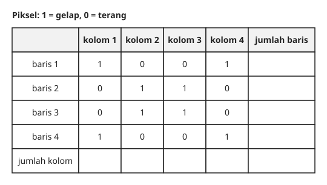

**Ingat dulu:** Jawab tanpa melihat catatan.

1. Apa pertanyaan pemeriksa untuk mencurigai hasil evaluasi yang terlalu bagus? ______
2. Mengapa dua model dengan ketepatan 0,958 dan 0,959 pada data kecil belum tentu berbeda? ______
3. Apa itu `Pipeline`, dan apa gunanya menaruh pengubahan skala di dalamnya? ______



`[Gambar: kisi 4 kali 4 (1 = gelap). Baris 1: 1 0 0 1. Baris 2: 0 1 1 0. Baris 3: 0 1 1 0. Baris 4: 1 0 0 1. Kolom "jumlah baris" dan baris "jumlah kolom" kosong untuk Latihan 1.]`

**Prediksi:** Tebak dan tulis keluarannya, baru jalankan. Gambar 4 kali 4 ini berbentuk tanda tambah (1 = gelap).

```python
import numpy as np

g = np.array([[0, 1, 0, 0], [0, 1, 0, 0], [1, 1, 1, 1], [0, 1, 0, 0]])
print(g.sum(axis=1))
print(g.sum(axis=0))
print(g.ravel())
```

Tiga keluaran: ______

Baris dan kolom mana yang berjumlah paling besar, dan apa artinya bagi bentuk gambar? ______

**Lengkapi:** Isi bagian `____` supaya program membuat gambar 5 kali 5 berbentuk tanda tambah, mencetak jumlah piksel gelap, dan mencetak jumlah angka setelah diratakan.

```python setengah-jadi
import numpy as np

g = np.zeros((5, 5), dtype=int)
g[____, :] = 1  # garis mendatar di baris tengah
g[:, ____] = 1  # garis tegak di kolom tengah
print(g.sum())
print(g.ravel().____)
```

**Susun:** Urutkan baris berikut menjadi program yang membuat gambar 3 kali 3 berbentuk tanda tambah lalu mencetak jumlah piksel gelap tiap kolom (dua baris penugasan garis boleh bertukar).

- A. `print(g.sum(axis=0))`
- B. `g[:, 1] = 1`
- C. `g = np.zeros((3, 3), dtype=int)`
- D. `import numpy as np`
- E. `g[1, :] = 1`

Urutan: ___ → ___ → ___ → ___ → ___

**Latihan:**

1. (`AI: tanpa AI`) Pada gambar, tulis jumlah tiap baris dan tiap kolom, lalu 16 bit setelah diratakan dan bilangan desimalnya bila dibaca sebagai satu bilangan biner. ______
2. (`AI: tanpa AI`) Tulis nilai fitur buatan (jumlah terbesar per baris, jumlah terbesar per kolom) yang kamu harapkan untuk garis mendatar, garis tegak, dan diagonal 8 kali 8 tanpa derau, dan mengapa satu piksel derau hanya menggesernya sedikit.

| Bentuk | Jumlah terbesar per baris | Jumlah terbesar per kolom |
| --- | --- | --- |
| garis mendatar | | |
| garis tegak | | |
| diagonal | | |

Alasannya: ______

**Cek diri:**

- [ ] Saya dapat menjelaskan gambar sebagai kisi angka dan meratakannya menjadi fitur.
- [ ] Saya dapat menjelaskan mengapa piksel mentah gagal pada letak baru.
- [ ] Saya dapat membuat fitur buatan dari gambar dan membandingkannya.

**Catatan cetak (untuk guru, tidak dicetak):** satu lembar, dua halaman A4. Kunci ada di modul `d-xi2-m6` bagian "Kunci dan petunjuk". Lembar tidak memuat kolom nama, kelas, tanggal, atau nilai.
