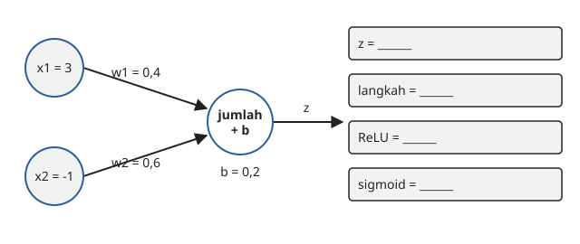

**Ingat dulu:** Jawab tanpa melihat catatan.

1. Apa yang dicatat tentang pemakaian AI dalam sebuah proyek? ______
2. Mengapa model pada piksel mentah bisa gagal pada gambar yang bentuknya sama tetapi letaknya bergeser? ______
3. Apa beda matriks hitungan kata dan TF-IDF, dan apa yang tidak ditangkap keduanya? ______



`[Gambar: masukan x1 = 3 dan x2 = -1 menuju satu neuron lewat bobot w1 = 0,4 dan w2 = 0,6, dengan bias b = 0,2. Di kanan, empat kotak kosong: z, langkah, ReLU, dan sigmoid. Dipakai di Latihan 1.]`

**Prediksi:** Tebak dan tulis keluarannya, baru jalankan: nilai jumlah berbobot `z`, lalu keluaran setelah aktivasi ReLU.

```python
x = [1, 0, 1]
w = [0.5, 0.9, -0.4]
b = -0.5
z = sum(xi * wi for xi, wi in zip(x, w)) + b
print(round(z, 2), round(max(0, z), 2))
```

Dua angka: ______

Mengapa bobot 0,9 tidak menyumbang? ______

**Lengkapi:** Isi bagian `____` supaya program menghitung keluaran neuron berfungsi ReLU dari `x = [1, 2]`, `w = [0,5; 0,25]`, dan `b = -1`.

```python setengah-jadi
x = [1, 2]
w = [0.5, 0.25]
b = -1
z = x[0] * w[0] + x[1] * ____ + ____
print(z)
print(max(____, z))
```

**Susun:** Urutkan baris berikut menjadi fungsi `relu` yang mengembalikan `z` bila positif dan 0 bila tidak, lalu mencetak `relu(-2)` dan `relu(3)`. Lekukan dipakai di sini.

```text
A.     return z if z > 0 else 0
B. print(relu(-2), relu(3))
C. def relu(z):
```

Urutan: ___ → ___ → ___

**Latihan:**

1. (`AI: tanpa AI`) Pada gambar, hitung `z`, keluaran langkah, ReLU, dan sigmoid (dua desimal).
2. (`AI: tanpa AI`) Jaringan dengan 4 masukan, satu lapis tersembunyi berisi 3 neuron, dan 1 keluaran. Berapa bobot, bias, dan seluruh parameternya? Gambar diagramnya dengan semua bagian diberi nama.

   Bobot: ______  Bias: ______  Parameter: ______
3. (`AI: boleh`) Ubah `laju` pada contoh satu bobot menjadi 0,3 dan 0,01, dan catat kerugian enam langkah pertama. Apa yang kamu lihat? ______

**Cek diri:**

- [ ] Saya dapat menghitung keluaran satu neuron dengan tangan.
- [ ] Saya dapat menghitung jumlah parameter jaringan berlapis.
- [ ] Saya dapat menjelaskan pelatihan dan laju belajar.

**Catatan cetak (untuk guru, tidak dicetak):** satu lembar, dua halaman A4. Kunci ada di modul `d-xi2-m7` bagian "Kunci dan petunjuk". Lembar tidak memuat kolom nama, kelas, tanggal, atau nilai.
