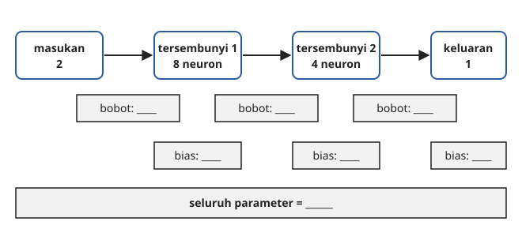

**Ingat dulu:** Jawab tanpa melihat catatan.

1. Sebutkan bagian satu neuron dan cara menghitung keluarannya. ______
2. Mengapa model teks gagal pada kalimat berpola "tidak" bila data latih tidak memuat pola itu, dan apa dua perbaikannya? ______
3. Mengapa pengubahan skala dipasang pada data latih saja? ______



`[Gambar: empat kotak lapisan berpanah: masukan 2, tersembunyi 1 (8 neuron), tersembunyi 2 (4 neuron), keluaran 1. Di bawah tiap panah kotak kosong untuk jumlah bobot, di bawah tiap lapis sesudah masukan kotak kosong untuk jumlah bias, dan di dasar kotak kosong untuk seluruh parameter. Dipakai di Latihan 1.]`

**Prediksi:** Jaringan memiliki 2 masukan, satu lapis tersembunyi berisi 4 neuron, dan 1 keluaran. Tebak dan tulis sebelum menjalankan:

```python
import numpy as np
from sklearn.neural_network import MLPClassifier

X = np.array([[0.0, 0.0], [0.0, 1.0], [1.0, 0.0], [1.0, 1.0]])
y = np.array([0, 1, 1, 0])
jaringan = MLPClassifier(hidden_layer_sizes=(4,), random_state=0)
jaringan.partial_fit(X, y, classes=[0, 1])
print([w.shape for w in jaringan.coefs_])
print([b.shape for b in jaringan.intercepts_])
print(sum(w.size for w in jaringan.coefs_) + sum(b.size for b in jaringan.intercepts_))
```

Bentuk tiap matriks bobot: ______  Bentuk tiap vektor bias: ______

Jumlah seluruh parameter: ______

**Lengkapi:** Isi bagian `____` agar jaringan satu lapis 8 neuron dengan skala di dalam `Pipeline` dinilai pada lipatan 5 yang diacak dengan `random_state=0`.

```python setengah-jadi
model = make_pipeline(____(), MLPClassifier(hidden_layer_sizes=(____,), max_iter=____, random_state=0))
skor = cross_val_score(model, X, y, cv=StratifiedKFold(n_splits=____, shuffle=True, random_state=0))
print(round(skor.mean(), 3))
```

**Susun:** Urutkan baris berikut menjadi program yang membagi data, mengubah skala dari data latih saja, melatih jaringan, dan mencetak ketepatan uji.

- A. `print(round(jaringan.score(skala.transform(X_uji), y_uji), 3))`
- B. `jaringan = MLPClassifier(hidden_layer_sizes=(16,), max_iter=2000, random_state=0)`
- C. `skala = StandardScaler().fit(X_latih)`
- D. `X_latih, X_uji, y_latih, y_uji = train_test_split(X, y, test_size=0.25, stratify=y, random_state=0)`
- E. `jaringan.fit(skala.transform(X_latih), y_latih)`

Urutan: ___ → ___ → ___ → ___ → ___

**Latihan:**

1. (`AI: tanpa AI`) Jaringan dengan 2 masukan, dua lapis tersembunyi berisi 8 dan 4 neuron, dan 1 keluaran. Isi gambar: berapa bobot, bias, dan seluruh parameternya?
2. (`AI: tanpa AI`) Pelatihan berhenti dengan `ConvergenceWarning` dan ketepatan ujinya rendah. Apa artinya, dan sebut tiga hal yang dicoba lebih dulu? ______
3. (`AI: boleh`) Nilai `hidden_layer_sizes` (2,), (16,), (64,), dan (16, 16) pada lipatan yang sama. Tulis kesimpulan hanya sejauh selisihnya melebihi sebaran. ______

**Cek diri:**

- [ ] Saya dapat menghitung jumlah parameter dari bentuk bobotnya.
- [ ] Saya dapat membaca kerugian, jumlah putaran, dan `ConvergenceWarning`.
- [ ] Saya dapat menilai apakah selisih ketepatan melebihi sebaran.

**Catatan cetak (untuk guru, tidak dicetak):** satu lembar, dua halaman A4. Kunci ada di modul `d-xi2-m8` bagian "Kunci dan petunjuk". Lembar tidak memuat kolom nama, kelas, tanggal, atau nilai.
