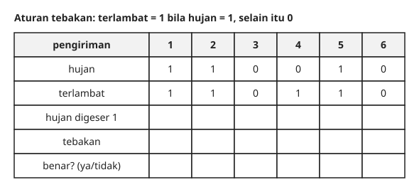

**Ingat dulu:** Jawab tanpa melihat catatan.

1. Mengapa k-means dijalankan beberapa kali (`n_init`), dan bagaimana memilih k? ______
2. Apa itu fitur buatan dari gambar, misalnya jumlah piksel gelap per baris, dan mengapa ia lebih tahan terhadap letak? ______
3. Mengapa selisih ketepatan yang lebih kecil daripada sebaran antar lipatan atau antar `random_state` belum membuktikan satu model lebih baik? ______



`[Gambar: tabel enam pengiriman. Baris hujan: 1 1 0 0 1 0. Baris terlambat: 1 1 0 1 1 0. Tiga baris kosong: hujan digeser 1, tebakan, dan benar (ya/tidak). Aturan tebakan: terlambat = 1 bila hujan = 1, selain itu 0.]`

**Prediksi:** Aturan sederhana menebak "terlambat" hanya dari `hujan`. Importansi permutasi menggeser melingkar satu kolom (kolom lain tetap) lalu melihat berapa ketepatan turun. Tebak dan tulis: ketepatan awal, penurunan rata-rata bila kolom `hujan` digeser 1 sampai 5 kali, dan penurunan bila kolom `jarak` yang digeser. Hitung geser 1 untuk `hujan` dengan tangan, memakai tabel pada gambar.

```python
hujan = [1, 1, 0, 0, 1, 0]
jarak = [5, 18, 7, 22, 12, 3]
terlambat = [1, 1, 0, 1, 1, 0]


def tebak(jarak_i, hujan_i):
    return 1 if hujan_i == 1 else 0  # aturan sederhana: hanya melihat hujan


def ketepatan(hujan_x, jarak_x):
    benar = sum(tebak(j, h) == t for j, h, t in zip(jarak_x, hujan_x, terlambat))
    return benar / len(terlambat)


def geser(daftar, k):
    return daftar[k:] + daftar[:k]  # permutasi sederhana: geser melingkar


awal = ketepatan(hujan, jarak)
print("ketepatan awal", round(awal, 3))
for nama in ("hujan", "jarak"):
    turun = []
    for k in range(1, 6):
        if nama == "hujan":
            turun.append(awal - ketepatan(geser(hujan, k), jarak))
        else:
            turun.append(awal - ketepatan(hujan, geser(jarak, k)))
    print(nama, "penurunan rata-rata", round(sum(turun) / len(turun), 3))
```

Ketepatan awal: ______  Penurunan `hujan`: ______  Penurunan `jarak`: ______

**Lengkapi:** Isi bagian `____` agar program menghitung importansi permutasi dengan 20 ulangan, lalu mencetak nama fitur, rata-rata, dan simpangan bakunya.

```python setengah-jadi
hasil = permutation_importance(hutan, X_uji, y_uji, n_repeats=____, random_state=0)
for nama, rata, sebar in zip(X.columns, hasil.____, hasil.importances_std):
    print(nama, round(rata, 3), round(sebar, 3))
```

**Susun:** Urutkan baris berikut menjadi fungsi `penurunan` yang menghitung berapa ketepatan turun bila satu kolom data uji diacak. Lekukan dipakai di sini.

```text
A.     return awal - model.score(salinan, y_uji)
B.     salinan[kolom] = acak.permutation(salinan[kolom].to_numpy())
C. def penurunan(model, X_uji, y_uji, kolom, acak):
D.     salinan = X_uji.copy()
E.     awal = model.score(X_uji, y_uji)
```

Urutan: ___ → ___ → ___ → ___ → ___

**Latihan:**

1. (`AI: tanpa AI`) Dari keluaran importansi permutasi pada data uji (model tanpa `jarak_mil`) berikut, sebut dua fitur yang paling dipakai model dan dua yang tidak. Apa arti nilai -0,002 pada `kode_acak`? Tulis satu kalimat yang boleh dan satu yang tidak boleh disimpulkan.

| Fitur | Rata-rata penurunan | Sebaran |
| --- | --- | --- |
| hujan | 0,131 | 0,025 |
| jarak_km | 0,101 | 0,022 |
| jam_sibuk | 0,024 | 0,020 |
| berat_kg | -0,001 | 0,013 |
| kode_acak | -0,002 | 0,010 |

Dua paling dipakai: ______  Dua tidak: ______  Arti -0,002: ______

Boleh disimpulkan: ______  Tidak boleh: ______

2. (`AI: boleh`) Pada data tanpa `jarak_mil`, tambahkan dua salinan jarak: `jarak_mil` (mil) dan `jarak_m` (meter), lalu hitung ulang importansi permutasi. Apa yang terjadi pada ketiga kolom jarak, dan apa salahnya menyimpulkan "jarak tidak penting"? ______
3. (`AI: tanpa AI`) Untuk model apa pun dari modul ini, tulis catatan lima baris: model dan data, apa yang diukur, hasil, tiga hal yang tidak boleh disimpulkan, dan batas.

**Cek diri:**

- [ ] Saya dapat menghitung dan membaca importansi permutasi beserta sebarannya.
- [ ] Saya dapat menjelaskan pengaruh fitur kembar pada peringkat.
- [ ] Saya dapat menulis catatan penjelasan dengan batas kesimpulan.

**Catatan cetak (untuk guru, tidak dicetak):** satu lembar, dua halaman A4. Kunci ada di modul `d-xi2-m9` bagian "Kunci dan petunjuk". Lembar tidak memuat kolom nama, kelas, tanggal, atau nilai.
