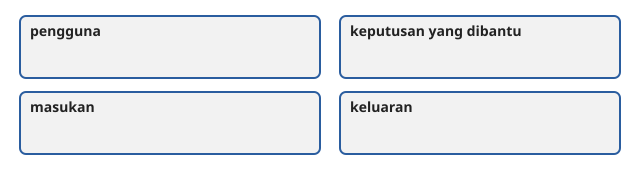

**Ingat dulu:** Jawab tanpa melihat catatan.

1. Sebutkan bagian satu neuron dan cara menghitung keluarannya. ______
2. Mengapa kartu model menyebut penggunaan yang di luar cakupannya? ______
3. Urutkan isi proyek model dari pertanyaan sampai kartu model. ______

`[Gambar: formulir pernyataan masalah dengan empat kotak kosong berlabel: pengguna, keputusan yang dibantu, masukan, dan keluaran. Dipakai di Latihan 1.]`

**Prediksi:** Perpustakaan desa fiktif "Pustaka Contoh" mencatat 200 peminjaman, dan 40 di antaranya (20 persen) dikembalikan terlambat. Tebak dan tulis:

1. Sebuah "model" yang selalu menjawab "tepat waktu" benar pada berapa persen peminjaman, dan menangkap berapa dari 40 yang terlambat? ______
2. Dari tiga kalimat kebutuhan berikut, mana yang dapat diuji dengan angka? (A) "Sistemnya harus pintar." (B) "Tandai peminjaman yang kemungkinan terlambat agar petugas mengirim pengingat; sasaran: menangkap sedikitnya 24 dari 40 yang terlambat." (C) "Modelnya harus akurat." Jawab: ______

**Lengkapi:** Warung fiktif "Warung Contoh" mencatat penjualan es teh harian dan pemiliknya, Pak Dimas (karangan), ingin menyiapkan stok.

1. Keputusan yang dibantu: ______. Masukan: hari dalam seminggu, cuaca, dan ______. Keluaran: ______.
2. Pembanding sederhana: "stok sama dengan penjualan ______ kemarin".
3. Ukuran sukses yang dapat diuji (sebutkan angka): galat rata-rata kurang dari ______ gelas.
4. Satu batas penggunaan: ______.

**Latihan:**

1. (`AI: boleh`) Tulis empat bagian pernyataan masalah untuk proyek akhirmu pada gambar. Bila memakai AI untuk memerankan tokoh fiktif, ingat jawabannya bukan bukti kebutuhan sungguhan.
2. (`AI: boleh`) Untuk tiap situasi, tulis aturan sederhana atau model dan alasannya.

| Situasi | Aturan sederhana atau model? | Alasan |
| --- | --- | --- |
| pengingat ulang tahun | | |
| menebak hasil panen dari curah hujan dan jumlah pupuk pada data karangan | | |
| membagi tamu ke meja | | |
| menandai ulasan produk yang bernada marah | | |

3. (`AI: tanpa AI`) Ubah "model harus akurat" menjadi ukuran dengan angka, data uji, dan pembanding. ______

**Cek diri:**

- [ ] Saya dapat menulis pernyataan masalah empat bagian.
- [ ] Saya dapat menilai perlu tidaknya pembelajaran mesin dengan pembanding.
- [ ] Saya dapat menulis ukuran sukses dan batas penggunaan yang dapat diuji.

**Catatan cetak (untuk guru, tidak dicetak):** satu lembar, dua halaman A4. Bagian Susun dilewati karena modul tidak memuat soal Parsons. Kunci ada di modul `d-xii1-m1` bagian "Kunci dan petunjuk". Lembar tidak memuat kolom nama, kelas, tanggal, atau nilai.
