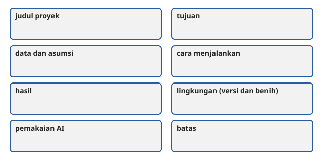

**Ingat dulu:** Jawab tanpa melihat catatan.

1. Mengapa fitur yang baru diketahui sesudah keputusan membuat angka uji tidak jujur, dan apa pertanyaan pemeriksanya? ______
2. Apa gunanya benih acak dan mencatat versi pustaka, dan apa yang dicatat bila AI dipakai? ______
3. Mengapa kelompok yang kurang terwakili di data uji membuat angka rata-rata menyesatkan? ______



`[Gambar: kerangka README dengan delapan kotak kosong berlabel: judul proyek, tujuan, data dan asumsi, cara menjalankan, hasil, lingkungan (versi dan benih), pemakaian AI, dan batas. Dipakai di Latihan 2.]`

**Prediksi:** Program membangkitkan lima angka dari sebuah benih. Tebak dan tulis, sebelum menjalankan: apa yang tercetak di baris pertama (dua perbandingan)? Lalu tebak: bila temanmu memakai versi `numpy` yang lebih baru, apakah angka pada benih 1 dijamin sama?

```python
import numpy as np


def acak(benih):
    return np.random.default_rng(benih).integers(0, 100, 5).tolist()


print(acak(1) == acak(1), acak(1) == acak(2))
print(acak(1))
```

Baris pertama: ______  Dijamin sama pada versi baru? ______

**Lengkapi:** Isi `____` agar benih ditetapkan di satu tempat dan program mencetak `True`.

```python setengah-jadi
import numpy as np

BENIH = ____


def acak(n, benih=____):
    return np.random.default_rng(____).integers(0, 10, n).tolist()


print(acak(3) == acak(3))
```

**Susun:** Urutkan baris berikut menjadi fungsi `format_versi` yang menghasilkan teks `nama versi`, lalu mencetaknya untuk `numpy` versi 2.5.5. Lekukan dipakai.

```text
A. print(format_versi("numpy", "2.5.5"))
B.     return f"{nama} {versi}"
C. def format_versi(nama, versi):
```

Urutan: ___ → ___ → ___

**Latihan:**

1. (`AI: tanpa AI`) Tulis README proyekmu pada kerangka di gambar. ______
2. (`AI: tanpa AI`) Seorang murid menulis di README: "dibantu AI". Sebutkan apa saja yang kurang. ______
3. (`AI: boleh`) Pilih satu skrip proyekmu. Beri nama pada angka ajaib, pecah menjadi fungsi satu tugas, hilangkan salinan kode, dan tambahkan `main`. Buktikan keluarannya sama sebelum dan sesudah. ______

**Cek diri:**

- [ ] Saya menetapkan benih di satu tempat dan membuktikan hasilnya dapat diulang.
- [ ] Saya dapat menulis README yang membuat orang lain bisa menjalankan ulang.
- [ ] Saya mencatat versi Python dan pustaka.

**Catatan cetak (untuk guru, tidak dicetak):** satu lembar, dua halaman A4. Kunci ada di modul `d-xii1-m10` bagian "Kunci dan petunjuk". Lembar tidak memuat kolom nama, kelas, tanggal, atau nilai.
