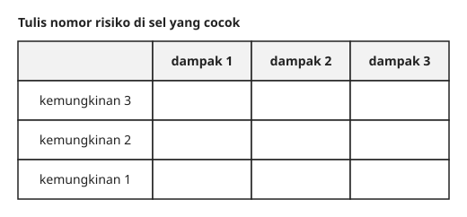

**Ingat dulu:** Jawab tanpa melihat catatan.

1. Sebutkan empat hal yang dicatat di README agar orang lain dapat mengulang hasilmu. ______
2. Mengapa eksperimen yang tidak menaikkan metrik tetap dicatat? ______
3. Mengapa model bisa tampak baik pada rata-rata tetapi gagal pada kondisi tertentu, dan bagaimana kamu menunjukkannya dengan angka? ______



`[Gambar: matriks risiko. Baris: kemungkinan 3, 2, dan 1. Kolom: dampak 1, 2, dan 3. Sembilan sel kosong untuk menulis nomor risiko. Dipakai di Latihan 2.]`

**Prediksi:** Model E1 Pustaka Contoh mencapai recall rata-rata 0,63 untuk peminjaman terlambat. Peminjamannya berjenis `anak`, `umum`, dan `referensi`. Tebak dan tulis: apakah recall-nya sama untuk ketiga jenis? Jenis mana yang paling sulit ditebak? Dan bila hanya 1 baris `referensi` yang terlambat, seberapa yakin kamu pada angka untuk jenis itu? ______

**Lengkapi:** Isi `____` agar risiko diurutkan dari skor tertinggi (skor = kemungkinan kali dampak).

```python setengah-jadi
risiko = [("pengingat salah dianggap tuduhan", 2, 2), ("model menolak peminjaman", 1, 3)]
for nama, k, d in sorted(risiko, key=lambda r: -(r[____] * r[____])):
    print(k * d, nama)
```

**Susun:** Urutkan baris berikut menjadi fungsi `cukup_bukti` yang benar bila jumlah baris positif sedikitnya `batas`, lalu mencetak hasil untuk 6 dan 19 baris. Lekukan dipakai.

```text
A. print(cukup_bukti(6), cukup_bukti(19))
B.     return positif >= batas
C. def cukup_bukti(positif, batas=10):
```

Urutan: ___ → ___ → ___

**Latihan:**

1. (`AI: tanpa AI`) Isi daftar periksa delapan butir untuk proyekmu; tiap jawaban disertai bukti (nama kolom, angka, atau berkas).

| Butir | Pertanyaan | Jawaban dan bukti |
| --- | --- | --- |
| 1 Data dan privasi | adakah kolom yang mengenali orang atau data spesifik? | |
| 2 Kepatuhan | lisensi, tujuan, dan dasar pemrosesan tercatat? | |
| 3 Keterwakilan | kelompok mana yang sedikit di data dan di data uji? | |
| 4 Dampak salah | positif palsu dan negatif palsu menimpa siapa, seberapa berat? | |

2. (`AI: boleh`) Tulis lima risiko proyekmu dengan kemungkinan dan dampak 1 sampai 3, tempatkan di matriks pada gambar, urutkan, dan tulis tindakan untuk dua teratas. ______
3. (`AI: tanpa AI`) Dua risiko sama-sama berskor 3: kemungkinan 3 dampak 1, dan kemungkinan 1 dampak 3. Mengapa keduanya tidak ditangani sama? ______

**Cek diri:**

- [ ] Saya dapat mengaudit model per kelompok dan menyebut kelompok yang buktinya tipis.
- [ ] Saya dapat mengurutkan risiko dan menyebut batas skor itu.
- [ ] Saya dapat menulis laporan risiko dengan tindakan dan risiko yang tersisa.

**Catatan cetak (untuk guru, tidak dicetak):** satu lembar, dua halaman A4. Daftar periksa pada Latihan 1 hanya memuat empat dari delapan butir agar muat satu halaman; kunci ada di modul `d-xii1-m11` bagian "Kunci dan petunjuk". Lembar tidak memuat kolom nama, kelas, tanggal, atau nilai.
