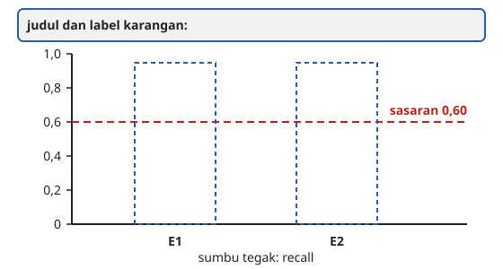

**Ingat dulu:** Jawab tanpa melihat catatan.

1. Mengapa angka rata-rata dapat menyembunyikan kelompok yang gagal, dan bagaimana kamu melaporkannya dengan jujur? ______
2. Apa tiga bagian umpan balik sejawat, dan mengapa ulasan menunjuk bukti, bukan orang? ______
3. Grafik apa untuk membandingkan, melihat perubahan, melihat hubungan, dan melihat sebaran? ______



`[Gambar: kerangka grafik batang recall dengan sumbu dari 0 sampai 1, garis putus-putus sasaran 0,60, dua posisi kosong berlabel E1 dan E2 untuk digambar, serta kotak kosong untuk judul dan label karangan. Dipakai di Latihan 2.]`

**Prediksi:** Dua grafik dibuat dari angka yang sama: recall E1 0,63 dan E2 0,67. Grafik A memakai sumbu dari 0 sampai 1 dengan garis sebaran dan garis sasaran. Grafik B hanya memuat E1 dan E2, sumbunya dipotong di 0,55 sampai 0,70, tanpa sebaran, berjudul "Model kami jauh lebih baik!". Tebak dan tulis: pada grafik B, batang E2 tampak berapa kali lebih tinggi daripada batang E1? Berapa kali lipat nilai sebenarnya?

Tampak: ______  Sebenarnya: ______

**Lengkapi:** Isi `____` agar program menghitung berapa kali tinggi tampak batang E2 dibanding E1 pada sumbu yang dipotong di 0,55.

```python setengah-jadi
e1, e2, dasar = 0.63, 0.67, 0.55
tampak = (____ - dasar) / (e1 - ____)
nyata = e2 / e1
print(round(tampak, 2), round(nyata, 2))
```

**Susun:** Urutkan baris berikut menjadi fungsi `tingkat_klaim` yang menjawab "didukung" bila selisih melebihi sebaran dan "belum terbukti" bila tidak, lalu mencetak hasil untuk dua pasang angka. Lekukan dipakai.

```text
A. print(tingkat_klaim(0.59, 0.31), tingkat_klaim(0.04, 0.31))
B.     return "didukung" if selisih > sebaran else "belum terbukti"
C. def tingkat_klaim(selisih, sebaran):
```

Urutan: ___ → ___ → ___

**Latihan:**

1. (`AI: tanpa AI`) Tulis satu kalimat pesan utama proyekmu, lengkap dengan angka, pembanding, dan batasnya. Lalu tulis tiga klaim: satu didukung, satu belum terbukti, satu tidak diketahui. ______
2. (`AI: boleh`) Gambar grafik hasil proyekmu pada kerangka: sumbu batang dari nol, pembanding, sebaran, sasaran, dan label bahwa datanya karangan. Tulis tiga kalimat tentang apa yang dilihat pembaca. ______
3. (`AI: tanpa AI`) Sebuah grafik garis memotong sumbu, tanpa judul sumber, dan hanya menampilkan eksperimen terbaik. Sebutkan perbaikannya. ______

**Cek diri:**

- [ ] Saya dapat menyebut pesan utama proyekku dengan angka, pembanding, dan batas.
- [ ] Saya dapat mengenali dan memperbaiki grafik yang menyesatkan.
- [ ] Saya dapat menulis klaim pada tiga tingkat.

**Catatan cetak (untuk guru, tidak dicetak):** satu lembar, dua halaman A4. Kunci ada di modul `d-xii1-m12` bagian "Kunci dan petunjuk". Lembar tidak memuat kolom nama, kelas, tanggal, atau nilai.
