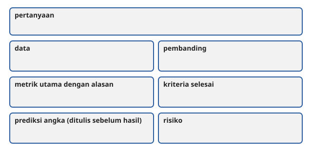

**Ingat dulu:** Jawab tanpa melihat catatan.

1. Apa enam bagian presentasi hasil proyek, dan bagian mana yang memuat batas dan risiko? ______
2. Apa yang dicatat bila kamu memakai AI untuk menulis kode proyek, dan bagian mana yang tetap kamu periksa sendiri? ______
3. Mengapa temuan dari data sintetis tidak boleh disajikan sebagai fakta tentang dunia nyata? ______

`[Gambar: formulir rencana proyek dengan tujuh kotak kosong berlabel: pertanyaan, data, pembanding, metrik utama dengan alasan, kriteria selesai, prediksi angka (ditulis sebelum hasil), dan risiko. Isi untuk proyekku.]`

**Lengkapi:** Tulis rencana **sebelum** menjalankan model baru. Isi tujuh kotak pada gambar untuk proyekmu. Ukuran sukses disalin dari dokumen kebutuhan.

**Latihan:**

1. (`AI: tanpa AI`) Sasaran presisi 0,50 belum dicapai E1 (sekitar 0,26). Tulis dua tanggapan yang sah dan satu yang tidak sah. ______
2. (`AI: tanpa AI`) Pilih dua risiko dari laporan risikomu dan tentukan fase semester dua yang menanganinya. ______
3. (`AI: boleh`) Tukar rencana dengan kelompok lain dan beri umpan balik dalam tiga kalimat: satu yang sudah baik, satu yang perlu diperbaiki, satu langkah berikutnya, masing-masing menunjuk bagian tertentu (baris rencana, angka, atau berkas). Pakai nama kelompok atau nomor, bukan nama orang.

Baik: ______

Perlu diperbaiki: ______

Langkah berikutnya: ______

**Cek diri:**

- [ ] Saya menulis rencana dengan prediksi dan kriteria selesai.
- [ ] Saya menilai kemajuan terhadap ukuran sukses tanpa membuka data uji.
- [ ] Saya memberi umpan balik tiga kalimat dan mengisi log AI bila memakainya.

**Catatan cetak (untuk guru, tidak dicetak):** satu lembar, dua halaman A4. Bagian Prediksi dan Susun dilewati, dan Lengkapi berupa pengisian rencana, karena modul ini berbentuk proyek tanpa soal kode semacam itu. Kunci ada di modul `d-xii1-m13` bagian "Kunci dan petunjuk". Lembar tidak memuat kolom nama, kelas, tanggal, atau nilai.
