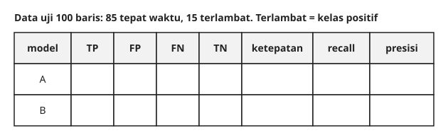

**Ingat dulu:** Jawab dari ingatan, di kertas. Yang masih lupa dicatat untuk diulang, bukan dihukum.

1. Pada data timpang, metrik apa yang menunjukkan bahwa tebakan mayoritas tidak berguna, dan bagaimana menghitungnya? ______
2. Mengapa perbaikan model diukur pada data validasi atau lipatan, bukan pada data uji, dan kapan data uji boleh dibuka? ______
3. Mengapa skor risiko kemungkinan kali dampak hanya alat prioritas? ______



`[Gambar: tabel dengan baris model A dan model B, kolom TP, FP, FN, TN, ketepatan, recall, dan presisi, semua sel kosong. Data uji 100 baris: 85 tepat waktu dan 15 terlambat; terlambat adalah kelas positif. Dipakai di Latihan 1.]`

**Prediksi:** Semua kolom dan label acak murni, jadi skor jujur sekitar 0,5. Tebak keluaran dua angka ini sebelum menjalankan.

```python
import numpy as np
from sklearn.linear_model import LogisticRegression
from sklearn.model_selection import train_test_split

KANDIDAT = [0.0001, 0.001, 0.01, 0.1, 1, 10, 100, 1000]
dilaporkan, segar = [], []
for ulang in range(100):
    acak = np.random.default_rng(ulang)
    X = acak.normal(size=(60, 20))
    y = acak.permutation([0, 1] * 30)  # label acak: tidak ada pola
    X_latih, X_uji, y_latih, y_uji = train_test_split(X, y, test_size=0.5, stratify=y, random_state=0)
    terbaik = max(KANDIDAT, key=lambda c: LogisticRegression(C=c, max_iter=5000).fit(X_latih, y_latih).score(X_uji, y_uji))
    model = LogisticRegression(C=terbaik, max_iter=5000).fit(X_latih, y_latih)
    dilaporkan.append(model.score(X_uji, y_uji))  # skor pada data yang dipakai MEMILIH
    X_baru = acak.normal(size=(300, 20))  # data segar, label acak juga
    y_baru = acak.permutation([0, 1] * 150)
    segar.append(model.score(X_baru, y_baru))
print(round(float(np.mean(dilaporkan)), 3), round(float(np.mean(segar)), 3))
```

Dua angka: ______  ______

**Latihan:** (kerjakan tanpa AI)

1. Data uji karangan 100 baris: 85 tepat waktu dan 15 terlambat. Model A menjawab "tepat waktu" untuk semua baris. Model B menandai 20 baris terlambat, 9 di antaranya memang terlambat. Isi tabel pada gambar, lalu putuskan mana yang berguna dan apakah ukuran sukses recall sedikitnya 0,60 dan presisi sedikitnya 0,50 terpenuhi. ______
2. Hasil lima lipatan data latih (karangan). Bandingkan selisih tiap baris dengan sebaran baris induknya, lalu tulis keputusan untuk E1, E2, dan E3, dan satu cacat pada baris E3.

| Kode | Dari | Perubahan | Recall (sebaran) | Keputusan |
| --- | --- | --- | --- | --- |
| E0 | - | bawaan | 0,10 (0,08) | - |
| E1 | E0 | bobot kelas seimbang | 0,60 (0,20) | |
| E2 | E1 | C = 0,1 | 0,64 (0,25) | |
| E3 | E1 | pohon dan tambah fitur | 0,30 (0,05) | |

Cacat pada E3: ______
3. Paket karangan "Tim Cemara": ketepatan 0,97 pada data uji, fitur menyertakan `tanggal_kembali_nyata` dan `nama_peminjam`, tanpa pembanding. Sebutkan tiga temuan dan tindakan masing-masing, lalu tulis ulasan tiga kalimat. ______

**Cek diri:**

- [ ] Saya dapat menghitung recall dan presisi dan membandingkannya dengan ukuran sukses.
- [ ] Saya dapat membaca tabel eksperimen dan menulis keputusan yang sah.
- [ ] Saya dapat mengenali kebocoran, termasuk saat memilih model.

**Catatan cetak (untuk guru, tidak dicetak):** satu lembar, dua halaman A4. Bagian Lengkapi dan Susun dilewati karena modul ulasan ini tidak memuatnya. Kunci ada di modul `d-xii1-m14` bagian "Kunci dan petunjuk". Lembar tidak memuat kolom nama, kelas, tanggal, atau nilai.
