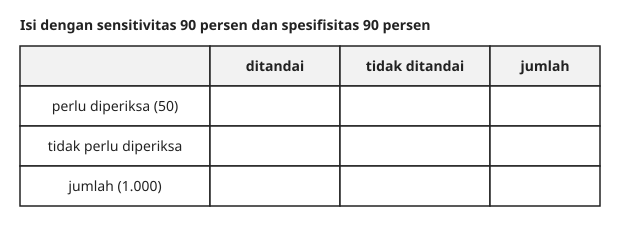

**Ingat dulu:** Jawab tanpa melihat catatan.

1. Sebutkan tiga hal yang dilaporkan di samping ketepatan rata-rata sebuah model agar klaimnya bisa dinilai. ______
2. Apa tiga hal yang kamu tanyakan pada klaim "model ini 95 persen akurat" sebelum mempercayainya? ______
3. Apa empat bagian pernyataan masalah? ______



`[Gambar: tabel dengan baris perlu diperiksa (50), tidak perlu diperiksa, dan jumlah (1.000); kolom ditandai, tidak ditandai, dan jumlah. Semua sel isian kosong. Dipakai pada soal Prediksi.]`

**Prediksi:** Sebuah aplikasi fiktif memakai data karangan. Dari 1.000 pengguna, 5 persen (50 orang) sebenarnya perlu diperiksa. Aplikasi menandai 90 persen dari mereka yang perlu (sensitivitas) dan membebaskan 90 persen dari mereka yang tidak perlu (spesifisitas). Tebak dan tulis, dengan bantuan tabel pada gambar: dari semua orang yang ditandai, berapa persen yang memang perlu diperiksa? Pilih: sekitar 90, 60, atau 30 persen. Jawab: ______

**Lengkapi:** Isi bagian `____` agar program menghitung tabel untuk 500 pengguna, prevalensi 10 persen, sensitivitas 80 persen, spesifisitas 90 persen. Fungsi `skrining` ada di bawah ini.

```python
def skrining(n, prevalensi, sensitivitas, spesifisitas):
    sakit = round(n * prevalensi)
    sehat = n - sakit
    tp = round(sakit * sensitivitas)
    fn = sakit - tp
    tn = round(sehat * spesifisitas)
    fp = sehat - tn
    presisi = tp / (tp + fp)
    return tp, fn, fp, tn, presisi
```

```python setengah-jadi
tp, fn, fp, tn, presisi = skrining(500, ____, 0.80, ____)
print(tp, fn, fp, tn, round(presisi, ____))
```

**Susun:** Urutkan baris berikut menjadi fungsi `presisi` yang mengembalikan bagian tanda yang benar, lalu mencetak hasil untuk TP = 45 dan FP = 95 dengan dua desimal. Lekukan dipakai.

```text
A. print(round(presisi(45, 95), 2))
B.     return tp / (tp + fp)
C. def presisi(tp, fp):
```

Urutan: ___ → ___ → ___

**Latihan:**

1. (`AI: boleh`) Jalankan `skrining` untuk prevalensi 1, 10, dan 50 persen dengan sensitivitas dan spesifisitas 90 persen. Pada prevalensi berapa tanda positif lebih sering benar daripada salah? ______
2. (`AI: tanpa AI`) Pada tabel UmpanEsai berikut, bila kelompok campuran hanya 10 esai dan 6 cocok, apakah angka 60 persen cukup kuat? Apa yang kamu minta sebelum menyimpulkan? ______

| Kelompok esai | Jumlah di data uji | Cocok dengan guru | Persen |
| --- | --- | --- | --- |
| bahasa baku | 160 | 136 | 85 |
| campuran bahasa daerah | 40 | 24 | 60 |
| semua | 200 | 160 | 80 |

3. (`AI: tanpa AI`) Tulis satu manfaat dan satu risiko UmpanEsai tanpa kata "AI menggantikan guru" dan tanpa "AI pasti adil". ______

**Cek diri:**

- [ ] Saya dapat menghitung proporsi tanda positif yang benar dari prevalensi, sensitivitas, dan spesifisitas.
- [ ] Saya dapat menunjukkan angka rata-rata yang menyembunyikan kelompok kecil.
- [ ] Saya dapat menulis catatan kasus dengan manfaat, risiko, pengaman, dan batas kesimpulan.

**Catatan cetak (untuk guru, tidak dicetak):** satu lembar, dua halaman A4. Kunci ada di modul `d-xii1-m2` bagian "Kunci dan petunjuk". Lembar tidak memuat kolom nama, kelas, tanggal, atau nilai.
