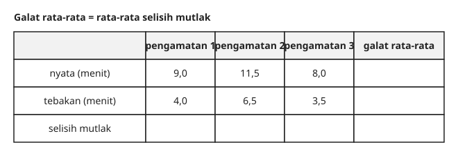

**Ingat dulu:** Jawab tanpa melihat catatan.

1. Mengapa "fitur X paling berpengaruh" belum membuktikan sebab, dan apa dua hal lain yang dapat membuat peringkat menyesatkan? ______
2. Mengapa "sensitivitas 90 persen dan spesifisitas 90 persen" belum memberi tahu seberapa sering tanda positif benar? ______
3. Apa tiga ciri kebutuhan yang dapat diuji, berbeda dari "modelnya harus akurat"? ______



`[Gambar: tabel tiga pengamatan. Nyata: 9,0; 11,5; 8,0. Tebakan: 4,0; 6,5; 3,5. Baris selisih mutlak dan sel galat rata-rata kosong. Dipakai pada soal Lengkapi.]`

**Prediksi:** Aplikasi fiktif "BusContoh" menebak menit keterlambatan bus dari kepadatan lalu lintas. Modelnya dilatih hanya pada **hari kering**, lalu diuji pada hari kering dan **hari hujan** (data karangan: hujan menambah sekitar 5 menit). Tebak dan tulis: galat rata-rata model pada hari kering kira-kira kecil atau besar? Pada hari hujan? Apakah model masih lebih baik daripada menebak rata-rata data latih? ______

**Lengkapi:** Isi bagian `____` agar program menghitung galat rata-rata pada hari hujan dari tiga pengamatan karangan pada gambar.

```python setengah-jadi
nyata = [9.0, 11.5, 8.0]
tebakan = [4.0, 6.5, 3.5]
selisih = [abs(t - n) for t, n in zip(____, ____)]
print(round(sum(selisih) / ____, 2))
```

**Susun:** Urutkan baris berikut menjadi fungsi `galat_rata` yang menghitung rata-rata selisih mutlak, lalu mencetak hasil untuk `[10, 12]` dan `[11, 15]`. Lekukan dipakai.

```text
A. print(galat_rata([10, 12], [11, 15]))
B.     return sum(abs(p - n) for p, n in zip(prediksi, nyata)) / len(nyata)
C. def galat_rata(prediksi, nyata):
```

Urutan: ___ → ___ → ___

**Latihan:**

1. (`AI: tanpa AI`) Tulis dua kalimat cakupan data latih untuk kartu model PadiWaspada (aplikasi pertanian karangan yang dilatih di dataran rendah dan dipakai di dataran tinggi), termasuk wilayah dan musim yang tidak tercakup. ______
2. (`AI: tanpa AI`) Tulis tiga pertanyaan yang kamu ajukan sebelum memakai naskah sebuah komunitas sebagai data latih. ______

**Cek diri:**

- [ ] Saya dapat menjelaskan pergeseran data dengan contoh.
- [ ] Saya dapat menulis cakupan data latih sebagai batas penggunaan.
- [ ] Saya dapat mengajukan pertanyaan tentang pemilik dan izin data budaya.

**Catatan cetak (untuk guru, tidak dicetak):** satu lembar, dua halaman A4. Kunci ada di modul `d-xii1-m3` bagian "Kunci dan petunjuk". Lembar tidak memuat kolom nama, kelas, tanggal, atau nilai.
