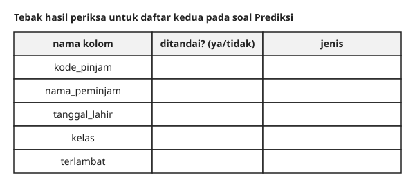

**Ingat dulu:** Jawab tanpa melihat catatan.

1. Apa tanda bahwa model yang dilatih pada satu kondisi akan gagal pada kondisi lain, dan apa yang ditulis tentang cakupan datanya? ______
2. Apa isi bagian "di luar cakupan" dan bagian "risiko dan privasi" di dokumen kebutuhan? ______
3. Sebutkan dua hak pemilik data pribadi menurut UU Pelindungan Data Pribadi. ______



`[Gambar: tabel lima nama kolom (kode_pinjam, nama_peminjam, tanggal_lahir, kelas, terlambat). Dua kolom kosong: ditandai (ya atau tidak) dan jenis (langsung, spesifik, atau kombinasi). Dipakai pada soal Prediksi.]`

**Prediksi:** Berikut pemeriksa kolom sederhana yang menandai kolom data dengan kata kunci. Tebak dan tulis keluaran baris pertama dan kedua sebelum menjalankan; kolom mana yang ditandai, dan apa jenisnya? Untuk baris kedua, isi tabel pada gambar.

```python
LANGSUNG = ["nama", "alamat", "telepon", "email", "nik", "nis"]
SPESIFIK = ["kesehatan", "golongan_darah", "biometrik", "wajah", "suara", "genetik"]
KOMBINASI = ["tanggal_lahir", "kode_pos", "jenis_kelamin", "kelas"]


def periksa(kolom):
    hasil = {}
    for k in kolom:
        if any(w in k for w in LANGSUNG):
            hasil[k] = "langsung"
        elif any(w in k for w in SPESIFIK):
            hasil[k] = "spesifik"
        elif any(w in k for w in KOMBINASI):
            hasil[k] = "kombinasi"
    return hasil


print(periksa(["kode", "tebal", "hari", "jenis", "musim_ujian", "terlambat"]))
print(periksa(["kode_pinjam", "nama_peminjam", "tanggal_lahir", "kelas", "terlambat"]))
```

Baris pertama: ______

**Lengkapi:** Perluas aturan agar `gol_darah` tertangkap. Isi `____`.

```python setengah-jadi
SPESIFIK = ["kesehatan", "golongan_darah", "biometrik", "wajah", "suara", "genetik", "____"]
print(any(w in "gol_darah" for w in SPESIFIK))
```

**Susun:** Urutkan baris berikut menjadi fungsi `periksa` yang menandai kolom bernama `nama` atau `kelas`, lalu mencetak jumlah kolom yang ditandai pada `["id", "nama", "kelas"]`. Lekukan dipakai.

```text
A. print(len(periksa(["id", "nama", "kelas"])))
B.     return {k: "periksa" for k in kolom if k in ("nama", "kelas")}
C. def periksa(kolom):
```

Urutan: ___ → ___ → ___

**Latihan:**

1. (`AI: boleh`) Tulis tiga daftar nama kolom. Cari satu tanda palsu dan satu kelolosan, lalu perbaiki aturannya tanpa menambah tanda palsu baru. ______
2. (`AI: tanpa AI`) Untuk tiap tindakan, tulis apakah kamu perlu izin dan dari siapa.

| Tindakan | Perlu izin? Dari siapa? |
| --- | --- |
| menguji aplikasi buatanmu di laptopmu | |
| mencoba masuk akun teman "hanya iseng" | |
| mengubah isi berkas milik sekolah | |
| menandai grafik data sintetis dengan "karangan" | |

**Cek diri:**

- [ ] Saya dapat menyusun dan memakai daftar periksa kepatuhan.
- [ ] Saya tahu batas pemeriksa otomatis.
- [ ] Saya dapat menyebut pokok UU PDP yang menyentuh proyek AI.

**Catatan cetak (untuk guru, tidak dicetak):** satu lembar, dua halaman A4. Kunci ada di modul `d-xii1-m4` bagian "Kunci dan petunjuk". Lembar tidak memuat kolom nama, kelas, tanggal, atau nilai.
