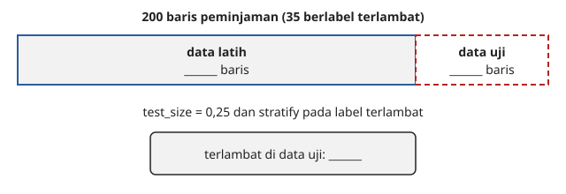

**Ingat dulu:** Jawab tanpa melihat catatan.

1. Sebutkan tiga pertanyaan daftar periksa kepatuhan sebelum memakai sebuah dataset. ______
2. Sebutkan lima pertanyaan lembar kasus untuk menimbang manfaat dan risiko sebuah sistem AI. ______
3. Mengapa data pribadi tidak dikirim ke layanan luar, dan apa penggantinya untuk latihan? ______



`[Gambar: batang 200 baris peminjaman (35 berlabel terlambat) dibagi menjadi data latih dan data uji, dengan isian jumlah baris tiap bagian dan jumlah terlambat di data uji. Pembagian: test_size = 0,25 dan stratify pada label terlambat.]`

**Prediksi:** Program membangkitkan 200 peminjaman karangan lalu membagi data dengan `test_size=0.25` dan `stratify` pada label. Tebak dan tulis: berapa baris latih dan baris uji? Bila 35 dari 200 baris berlabel terlambat, kira-kira berapa yang masuk data uji? Apakah `stratify` mengubah jumlah itu?

```python
latih, uji = train_test_split(data, test_size=0.25, stratify=data["terlambat"], random_state=BENIH)
print(len(latih), len(uji), latih["terlambat"].sum(), uji["terlambat"].sum())
```

Jawab: ______

**Lengkapi:** Pakai `data` dari program itu. Isi `____` agar program mencetak proporsi baris terlambat dengan tiga desimal.

```python setengah-jadi
jumlah = len(data)
terlambat = int(data["terlambat"].sum())
print(round(____ / ____, 3))
```

**Susun:** Urutkan baris berikut menjadi fungsi `ada_ganda` yang menjawab apakah ada kode yang berulang, lalu mencetak hasil untuk dua daftar. Lekukan dipakai.

```text
A. print(ada_ganda(["P1", "P2", "P1"]), ada_ganda(["P1", "P2"]))
B.     return len(kode) != len(set(kode))
C. def ada_ganda(kode):
```

Urutan: ___ → ___ → ___

**Latihan:**

1. (`AI: boleh`) Untuk proyek akhirmu, tulis apakah memakai data terbuka atau sintesis, alasannya, dan untuk data terbuka: alamat, lisensi, tanggal akses, dan perubahan yang kamu rencanakan. ______
2. (`AI: tanpa AI`) Tulis catatan sumber dan data untuk proyekmu dengan tujuh butir.

| Butir | Isi |
| --- | --- |
| asal | |
| lisensi | |
| baris dan kolom | |
| label | |
| asumsi | |
| batas | |
| privasi | |

**Cek diri:**

- [ ] Saya dapat memilih antara data terbuka dan sintetis dengan alasan.
- [ ] Saya dapat memeriksa nilai hilang, baris ganda, dan proporsi label.
- [ ] Saya dapat membagi data dan menyimpan data uji.

**Catatan cetak (untuk guru, tidak dicetak):** satu lembar, dua halaman A4. Kunci ada di modul `d-xii1-m5` bagian "Kunci dan petunjuk". Lembar tidak memuat kolom nama, kelas, tanggal, atau nilai.
