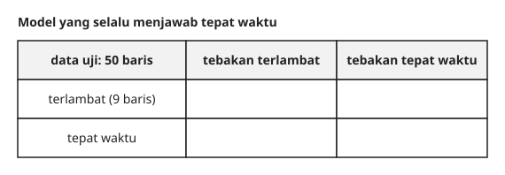

**Ingat dulu:** Jawab tanpa melihat catatan.

1. Mengapa data dibagi menjadi latih dan uji sebelum melihat hasil model, dan apa itu `random_state`? ______
2. Mengapa peta kasus menanyakan siapa yang tidak terwakili di data? ______
3. Mengapa kartu model melaporkan pembanding dan metrik yang dipilih beserta alasannya? ______



`[Gambar: tabel dua kali dua. Baris: terlambat (9 baris) dan tepat waktu. Kolom: tebakan terlambat dan tebakan tepat waktu. Keempat sel kosong; isi untuk model yang selalu menjawab "tepat waktu" pada 50 baris uji.]`

**Prediksi:** Pada data uji Pustaka Contoh (50 baris, 9 di antaranya terlambat), sebuah "model" selalu menjawab "tepat waktu". Tebak dan tulis, dengan tabel pada gambar: berapa ketepatannya, dan berapa recall untuk kelas terlambat? Tebak juga apakah aturan "buku 300 halaman atau lebih pada musim ujian" akan mengalahkannya pada ketepatan.

Ketepatan: ______  Recall: ______  Aturan mengalahkan pada ketepatan? ______

**Lengkapi:** Isi `____` agar program menghitung ketepatan dan presisi aturan tulisan tangan dari angka TP, FP, FN, TN.

```python setengah-jadi
tp, fp, fn, tn = 3, 6, 6, 35
ketepatan = (tp + ____) / (tp + fp + fn + ____)
presisi = tp / (tp + ____)
print(round(ketepatan, 2), round(presisi, 2))
```

**Susun:** Urutkan baris berikut menjadi fungsi `recall` dan cetak hasilnya untuk TP = 3 dan FN = 6 dengan dua desimal. Lekukan dipakai.

```text
A. print(round(recall(3, 6), 2))
B.     return tp / (tp + fn)
C. def recall(tp, fn):
```

Urutan: ___ → ___ → ___

**Latihan:**

1. (`AI: tanpa AI`) Model A ketepatannya 0,86 dan pembandingnya 0,82 pada 50 baris uji. Apakah itu membuktikan model A lebih baik? Berapa baris selisihnya? ______
2. (`AI: tanpa AI`) Untuk tiap situasi, pilih metrik utama dan beri alasan.

| Situasi | Metrik utama | Alasan |
| --- | --- | --- |
| menyaring surel penipuan dengan hasil masuk kotak spam | | |
| memberi tanda pada pasien yang perlu pemeriksaan lanjutan (data karangan) | | |
| mengirim promosi ke pelanggan fiktif | | |

**Cek diri:**

- [ ] Saya dapat menghitung ketepatan, presisi, dan recall dari matriks.
- [ ] Saya dapat memilih metrik utama sesuai dampak kesalahan.
- [ ] Saya dapat membaca selisih kecil dengan jujur.

**Catatan cetak (untuk guru, tidak dicetak):** satu lembar, dua halaman A4. Kunci ada di modul `d-xii1-m6` bagian "Kunci dan petunjuk". Lembar tidak memuat kolom nama, kelas, tanggal, atau nilai.
