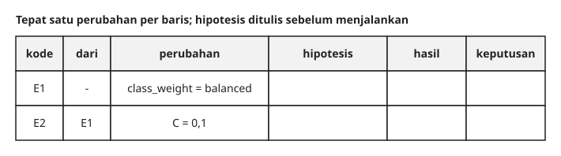

**Ingat dulu:** Jawab tanpa melihat catatan.

1. Mengapa garis dasar dihitung dengan data uji yang sama seperti model yang dibandingkan, dan apa yang terjadi bila model tidak mengalahkannya? ______
2. Apa itu penilaian dampak pelindungan data pribadi, dan kapan ia diwajibkan (sebutkan dua kondisi)? ______
3. Apa yang dicatat agar eksperimen perbaikan model dapat diulang orang lain? ______



`[Gambar: tabel eksperimen berkolom kode, dari, perubahan, hipotesis, hasil, dan keputusan. Baris E1: class_weight = balanced. Baris E2 (dari E1): C = 0,1. Kolom hipotesis, hasil, dan keputusan kosong.]`

**Prediksi:** Regresi logistik bawaan jarang menandai peminjaman terlambat karena kelas itu minoritas (35 dari 200 baris). Satu perubahan: `class_weight="balanced"`, yang memberi bobot lebih besar pada kelas minoritas saat melatih. Tebak dan tulis: recall kelas terlambat akan naik atau turun, dan apa harganya pada presisi? Tebak juga apakah angkanya stabil di kelima lipatan. Tulis hipotesismu pada baris E1 di gambar. ______

**Lengkapi:** Tambahkan eksperimen E2 yang hanya mengubah kekuatan regularisasi `C` dari E1. Isi `____`.

```python setengah-jadi
eksperimen("E2", "E1 dengan C = 0.1", LogisticRegression(max_iter=1000, class_weight="____", C=____))
```

**Susun:** Urutkan baris berikut menjadi fungsi `rata` yang menghitung rata-rata, lalu mencetak rata-rata recall tiga lipatan `[0.5, 0.75, 0.25]` dengan dua desimal. Lekukan dipakai.

```text
A. print(round(rata([0.5, 0.75, 0.25]), 2))
B.     return sum(nilai) / len(nilai)
C. def rata(nilai):
```

Urutan: ___ → ___ → ___

**Latihan:**

1. (`AI: boleh`) Pilih satu perubahan untuk model proyekmu dengan hipotesis tertulis, ukur pada lipatan data latih, dan tulis satu baris catatan eksperimen. ______
2. (`AI: tanpa AI`) Seseorang mengubah bobot kelas dan menambah fitur sekaligus, dan recall naik. Mengapa kamu belum tahu mana yang membantu, dan apa yang kamu lakukan? ______
3. (`AI: tanpa AI`) Temanmu memilih perubahan dengan melihat hasil pada data uji beberapa kali. Apa yang salah dengan angka akhirnya? ______

**Cek diri:**

- [ ] Saya dapat mengubah satu hal per eksperimen dan mengukurnya pada lipatan.
- [ ] Saya dapat membaca rata-rata dan sebaran antar lipatan.
- [ ] Saya dapat menulis catatan eksperimen yang dapat diulang.

**Catatan cetak (untuk guru, tidak dicetak):** satu lembar, dua halaman A4. Kunci ada di modul `d-xii1-m7` bagian "Kunci dan petunjuk". Lembar tidak memuat kolom nama, kelas, tanggal, atau nilai.
