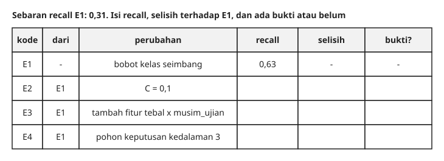

**Ingat dulu:** Jawab tanpa melihat catatan.

1. Mengapa hanya satu hal diubah per eksperimen, dan apa yang dicatat di tabel eksperimen? ______
2. Apa yang dicatat di catatan sumber dan data, dan mengapa data sintetis harus menyebut asumsinya? ______
3. Mengapa selisih ketepatan yang lebih kecil daripada sebaran antar lipatan belum membuktikan satu model lebih baik? ______



`[Gambar: tabel eksperimen. E1: bobot kelas seimbang, recall 0,63. E2 (dari E1): C = 0,1. E3 (dari E1): tambah fitur tebal x musim_ujian. E4 (dari E1): pohon keputusan kedalaman 3. Kolom recall, selisih, dan bukti kosong untuk E2 sampai E4. Sebaran recall E1: 0,31.]`

**Prediksi:** E1 mencapai recall 0,63 dengan sebaran 0,31. Tiga eksperimen berikutnya masing-masing mengubah satu hal dari E1 (lihat gambar). Tebak dan tulis: manakah yang selisih recall-nya terhadap E1 melebihi sebaran 0,31? Tebak juga: bila seluruh program dijalankan dua kali, apakah tabelnya sama? ______

**Lengkapi:** Isi `____` agar program menilai selisih E2 terhadap E1.

```python setengah-jadi
e1, sebaran_e1, e2 = 0.63, 0.31, 0.67
selisih = round(____ - e1, 2)
print(selisih, "ada bukti" if abs(selisih) > ____ else "belum terbukti")
```

**Susun:** Urutkan baris berikut menjadi fungsi `bukti` yang benar bila selisih melebihi sebaran, lalu mencetak hasil untuk dua pasang angka. Lekukan dipakai.

```text
A. print(bukti(0.67, 0.63, 0.31), bukti(0.90, 0.63, 0.10))
B.     return abs(baru - lama) > sebaran
C. def bukti(baru, lama, sebaran):
```

Urutan: ___ → ___ → ___

**Latihan:**

1. (`AI: tanpa AI`) Sebuah baris tabel berbunyi "E5 | tambah fitur | recall naik | dipakai". Sebutkan paling sedikit empat hal yang kurang. ______
2. (`AI: tanpa AI`) Temanmu menulis hipotesis E3 setelah melihat hasilnya. Mengapa itu menyesatkan? ______
3. (`AI: boleh`) Untuk proyekmu, tulis tiga baris tabel eksperimen: tiap baris punya kode induk, tepat satu perubahan, dan hipotesis yang ditulis sebelum menjalankan. ______

**Cek diri:**

- [ ] Saya dapat menulis tabel eksperimen lengkap dengan kode induk dan keputusan.
- [ ] Saya menulis hipotesis sebelum menjalankan dan keputusan sesudahnya.
- [ ] Saya menilai selisih terhadap sebaran dan berani menulis "belum terbukti".

**Catatan cetak (untuk guru, tidak dicetak):** satu lembar, dua halaman A4. Kunci ada di modul `d-xii1-m8` bagian "Kunci dan petunjuk". Lembar tidak memuat kolom nama, kelas, tanggal, atau nilai.
