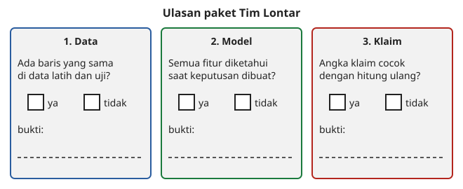

**Ingat dulu:** Tanpa melihat catatan, jawab. (1) Mengapa ketepatan 80 persen bisa tak berarti pada data yang 80 persen berkelas mayoritas? ______ (2) Apa tiga ciri kebutuhan yang dapat diuji, berbeda dari "modelnya harus akurat"? ______



`[Gambar: lembar ulasan dengan tiga kolom: Data, Model, dan Klaim. Tiap kolom memuat satu pertanyaan (ada baris yang sama di data latih dan uji? semua fitur diketahui saat keputusan dibuat? angka klaim cocok dengan hitung ulang?), dua kotak berlabel ya dan tidak, dan satu garis kosong untuk bukti. Setelah menjalankan program contoh pada modul, kamu mengisi kotak dan garis itu untuk paket Tim Lontar.]`

**Prediksi:** Tim karangan "Tim Lontar" melaporkan recall 1,00 dan presisi 1,00 pada 50 baris data uji (9 di antaranya terlambat). Fiturnya: `tebal`, `hari`, `musim_ujian`, dan `hari_lewat` (berapa hari buku dikembalikan melewati tenggat). Tebak dulu, tulis, baru jalankan. Apa yang janggal dari angka itu? ______ Bolehkah `hari_lewat` dipakai untuk menebak keterlambatan pada saat peminjaman dibuat? ______ Bila kolom itu dibuang, kira-kira ke mana recall-nya? ______

**Lengkapi:** Program menghitung ulang klaim dari 8 tebakan benar dan 9 peminjaman terlambat seluruhnya, tanpa tebakan positif yang salah. Isi bagian `____`.

```python setengah-jadi
tp, fn, fp = 8, ____, 0
recall = tp / (tp + ____)
presisi = tp / (tp + ____)
print(round(recall, 2), round(presisi, 2), "klaim 1.0 cocok?", recall == 1.0)
```

**Susun:** Urutkan baris A sampai C menjadi fungsi `klaim_cocok`, yang benar bila klaim dan hasil hitung ulang selisih kurang dari 0,005, lalu mencetak hasil untuk dua pasang angka. Lekukan sudah benar; hanya urutannya diacak. `AI: tanpa AI`.

```text
(A) print(klaim_cocok(1.0, 0.89), klaim_cocok(0.89, 0.89))
(B)     return abs(klaim - hitung) < 0.005
(C) def klaim_cocok(klaim, hitung):
```

Urutanku: ______ , ______ , ______

**Latihan:**

1. Tulis ulasan untuk Tim Lontar dalam tiga kalimat: satu yang baik, satu yang perlu diperbaiki, satu langkah berikutnya, masing-masing menunjuk bukti. `AI: tanpa AI` ______
2. Tulis ulang "Modelmu jelek dan kamu malas" menjadi ulasan yang menunjuk bukti dan menilai karya, bukan orang. `AI: tanpa AI` ______
3. Dari `d-xii1-m6`: tim lain mengklaim ketepatan 0,86 pada data uji yang 82 persen berkelas mayoritas. Apa yang kamu minta sebelum terkesan? `AI: boleh` ______
4. Untuk tiap fitur di proyekmu sendiri, tulis: "apakah ini sudah diketahui saat keputusan dibuat?" `AI: boleh` ______

**Cek diri:**

- [ ] Saya dapat memakai lembar ulasan data, model, dan klaim.
- [ ] Saya dapat menghitung ulang metrik dari prediksi dan membandingkannya dengan klaim.
- [ ] Saya dapat menulis ulasan tiga kalimat yang menunjuk bukti.

**Catatan cetak (untuk guru, tidak dicetak):** satu halaman A4, dicetak satu sisi. Kunci ada di modul `d-xii1-m9` bagian "Kunci dan petunjuk". Lembar tidak memuat kolom identitas (nama, kelas, tanggal, atau nilai).
