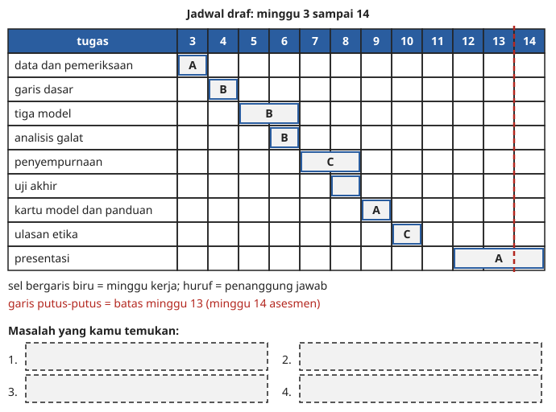

**Ingat dulu:** Tanpa melihat catatan, jawab. (1) Mengapa perbaikan model diukur pada data validasi atau lipatan, bukan pada data uji, dan kapan data uji boleh dibuka? ______ (2) Mengapa grafik batang dimulai dari nol? ______ (3) Sebutkan tujuh bagian rencana proyek. ______

`[Gambar: papan jadwal draf. Baris: sembilan tugas, dari "data dan pemeriksaan" sampai "presentasi". Kolom: minggu 3 sampai 14. Sel bergaris biru menandai minggu kerja tiap tugas dan huruf A, B, atau C adalah penanggung jawabnya. Garis putus-putus merah memisahkan minggu 13 dari minggu 14. Di bawah ada empat kotak kosong bernomor 1 sampai 4 untuk menulis masalah yang kamu temukan.]`

**Prediksi:** Jadwal draf pada gambar memuat empat masalah. Tebak dan tulis masalah itu sebelum menjalankan program apa pun. Aturan pemeriksanya: tiap tugas punya penanggung jawab, selesai paling lambat minggu 13, tidak ada orang yang memegang dua tugas di minggu yang sama, dan tidak ada minggu kosong. Tulis masalahmu pada empat kotak di gambar.

**Latihan:**

1. `AI: tanpa AI` Dari `d-xii1-m1`: ubah "modelnya harus akurat" menjadi kebutuhan yang dapat diuji untuk topik proyekmu. ______
2. `AI: boleh` Dari `d-xii1-m11`: pilih dua risiko dari laporan risikomu dan tulis minggu penanganannya pada jadwal. ______
3. Tulis tiga kalimat umpan balik untuk rencana tim lain (sebut tim dengan nomor, bukan nama): satu yang sudah baik, satu yang perlu diperbaiki, satu langkah berikutnya. Masing-masing menunjuk bagian tertentu. ______
4. Tulis urutan pemotongan lingkup proyekmu bila waktu habis, dan sebut bagian yang tidak boleh dipotong. ______

**Cek diri:**

- [ ] Saya dapat memilih topik yang layak dengan empat syarat.
- [ ] Saya dapat membagi peran dan jadwal dengan satu pemilik tiap tugas.
- [ ] Saya dapat menulis urutan pemotongan lingkup dan risiko dengan minggu penanganan.

**Catatan cetak (untuk guru, tidak dicetak):** satu sampai dua halaman A4. Kunci ada di modul `d-xii2-m1`, bagian "Kunci dan petunjuk". Lembar tidak memuat kolom identitas.
