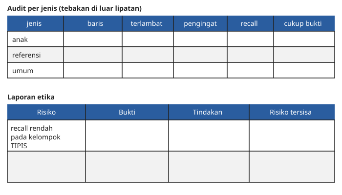

**Ingat dulu:** Tanpa melihat catatan, jawab. (1) Kapan sasaran boleh diubah, dan apa yang dicatat dalam catatan perubahan? ______ (2) Mengapa skor risiko kemungkinan kali dampak hanya alat prioritas? ______



`[Gambar: dua tabel. Atas: audit per jenis (anak, referensi, umum) dengan kolom baris, terlambat, dapat pengingat, recall, dan cukup bukti, semua kosong. Bawah: laporan etika dengan empat kolom (Risiko, Bukti, Tindakan, Risiko tersisa) dan dua baris; kolom Risiko baris pertama sudah berisi "recall rendah pada kelompok TIPIS", sisanya kosong.]`

**Prediksi:** Pemindai privasi dijalankan pada data proyek dan pada salinan yang sengaja dicemari kolom nama dan surel fiktif. Audit per kelompok memakai tebakan di luar lipatan dengan ambang 0,55. Tebak dulu, tulis, baru jalankan: apakah pemindai menemukan sesuatu pada data proyek, dan pada salinan yang dicemari? ______ Jenis buku mana yang paling jarang diingatkan? ______

**Lengkapi:** Isi bagian `____` agar pemindai mengenali kolom bernama pribadi dan nilai berpola surel.

```python setengah-jadi
POLA_SUREL = re.compile(r"[^@\s]+____[^@\s]+\.[a-z]+")
for kolom in data.columns:
    if any(k in kolom.lower().split("____") for k in KATA_KOLOM):
        temuan.append(f"nama kolom mencurigakan: {kolom}")
```

Apa yang lolos dari pemindai ini? ______

Setelah menjalankan program pada modul, isi tabel audit pada gambar dan satu baris laporan etika.

**Latihan:**

1. Tulis satu baris laporan etika untuk risiko "recall rendah pada kelompok TIPIS" dengan empat kolom. `AI: boleh` ______
2. Kolom `kode` unik untuk tiap peminjaman. Apakah itu penanda yang mengenali orang? Tulis alasannya dan satu pemeriksaan untuk memastikannya. `AI: tanpa AI` ______
3. Dari `d-xii1-m11`: beri skor kemungkinan dan dampak 1 sampai 3 pada risiko data pribadi terbawa, lalu jelaskan mengapa urutan skor bukan ukuran pasti. `AI: boleh` ______
4. Mengapa hasil per kelompok dibaca bersama jumlah barisnya sebelum menyimpulkan ketidakadilan? ______

**Cek diri:**

- [ ] Saya dapat memindai data dan menyebut batas pemindaian.
- [ ] Saya dapat mengaudit hasil per kelompok tanpa membuka data uji lagi.
- [ ] Saya membedakan temuan di data dari keputusan tentang keadilan.

**Catatan cetak (untuk guru, tidak dicetak):** satu halaman A4, dicetak satu sisi. Kunci ada di modul `d-xii2-m10` bagian "Kunci dan petunjuk". Lembar tidak memuat kolom identitas (nama, kelas, tanggal, atau nilai).
