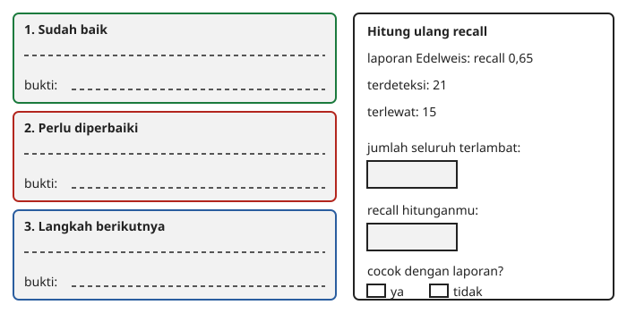

**Ingat dulu:** Tanpa melihat catatan, jawab. (1) Apa isi catatan kualitas data, dan apa yang membuktikan berkas data tidak berubah sejak diperiksa? ______ (2) Apa tiga bagian umpan balik sejawat, dan mengapa ulasan menunjuk bukti, bukan orang? ______



`[Gambar: dua bagian. Kiri: formulir ulasan dengan tiga kotak berlabel 1 Sudah baik, 2 Perlu diperbaiki, 3 Langkah berikutnya, tiap kotak punya garis isian kosong dan satu garis berlabel bukti. Kanan: kotak hitung ulang recall: tertulis laporan Edelweis recall 0,65, terdeteksi 21, terlewat 15, lalu kotak kosong untuk jumlah seluruh terlambat, recall hitungan sendiri, dan cocok atau tidak.]`

**Prediksi:** Program pada modul menilai dua paket fiktif, Tim Dahlia dan Tim Edelweis, dengan tujuh butir: sidik, pembanding, jumlah baris, selang, sasaran, log AI, dan label karangan. Tebak dulu, tulis: berapa butir terpenuhi tiap paket? ______ Bila sebuah paket memenuhi tujuh dari tujuh, apakah semua klaimnya pasti benar? ______

**Lengkapi:** Isi bagian `____` agar butir sidik lolos hanya bila sidik dicatat dan data uji dibuka paling banyak satu kali.

```python setengah-jadi
def ulas(paket):
    temuan = []
    for kunci, tanya, tindakan in PERIKSA:
        lolos = paket[kunci]
        if kunci == "sidik":
            lolos = lolos ____ paket["uji_dibuka"] <= ____
        if not lolos:
            temuan.append((tanya, tindakan))
    return temuan
```

Hitung ulang angka laporan Edelweis pada gambar, lalu tulis temuanmu dalam satu kalimat. ______

**Latihan:**

1. Paket Edelweis menulis recall 0,65 dengan 21 terdeteksi dan 15 terlewat. Hitung ulang dan tulis temuan satu kalimat. `AI: tanpa AI` ______
2. Dari `d-xii2-m9`: tambahkan satu butir pada daftar `PERIKSA` untuk bagian Di luar cakupan, lalu sebut apa yang tetap tak dapat diperiksanya. `AI: boleh` ______
3. Dari `d-xii2-m3`: tulis dua pertanyaan pengulas tentang catatan kualitas data tim lain. `AI: boleh` ______
4. Apa yang tidak dapat diperiksa oleh daftar periksa ulasan otomatis, dan apa yang dilakukan pengulas? ______

**Cek diri:**

- [ ] Saya dapat menghitung ulang satu angka laporan.
- [ ] Saya dapat menulis ulasan tiga bagian yang menunjuk bukti.
- [ ] Saya dapat menjawab ulasan dengan tindakan atau alasan.

**Catatan cetak (untuk guru, tidak dicetak):** satu halaman A4, dicetak satu sisi. Kunci ada di modul `d-xii2-m11` bagian "Kunci dan petunjuk". Lembar tidak memuat kolom identitas (nama, kelas, tanggal, atau nilai).
