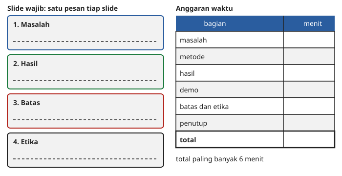

**Ingat dulu:** Tanpa melihat catatan, jawab. (1) Mengapa slide hasil selalu memuat pembanding sederhana di samping model? ______ (2) Apa tiga tingkat klaim pada narasi hasil, dan beri satu contoh tiap tingkat? ______



`[Gambar: kiri, empat kotak slide berlabel Masalah, Hasil, Batas, dan Etika, tiap kotak punya satu garis kosong untuk satu pesan. Kanan, tabel anggaran waktu dengan enam baris (masalah, metode, hasil, demo, batas dan etika, penutup), kolom menit kosong, dan baris total dengan kotak kosong. Di bawah tabel tertulis: total paling banyak 6 menit.]`

**Prediksi:** Program pada modul memulihkan rilis kandidat, memeriksa sidiknya, lalu menebak tiga peminjaman karangan: (1) buku umum 450 halaman, berjangka 7 hari, musim ujian; (2) buku anak 80 halaman, 14 hari, bukan musim ujian; (3) buku referensi 120 halaman, 21 hari, musim ujian. Ambang 0,55. Tebak dulu, tulis: peminjaman mana yang ditandai ingatkan? ______ Temuan apa yang dihasilkan pemeriksa slide untuk draf slide yang sengaja dibuat kurang? ______

**Lengkapi:** Isi bagian `____` agar pemeriksa slide melaporkan slide yang tidak ada.

```python setengah-jadi
def periksa_slide(slide):
    temuan = []
    for peran, kata in WAJIB.items():
        if peran ____ slide:
            temuan.append(f"slide {peran} tidak ada")
        elif not any(k in slide[peran].lower() for k in kata):
            temuan.append(f"slide {peran}: belum memuat salah satu dari {', '.join(kata)}")
    return temuan
```

Pada gambar, tulis satu pesan untuk tiap slide proyekmu dan isi anggaran menit tanpa melampaui enam menit.

**Latihan:**

1. Tulis ulang slide hasil yang buruk ("Hasil: model recall 0,56, kami sangat puas") menjadi slide dengan pembanding, selang kasar, dan jumlah baris, tanpa kata "puas". `AI: boleh` ______
2. Dari `d-xii2-m8`: tulis dua kalimat untuk slide batas tentang sasaran baru yang terpenuhi kurang dari satu baris. `AI: tanpa AI` ______
3. Apa yang dilakukan bila demo gagal saat presentasi, dan apa yang tidak dilakukan? ______
4. Mengapa demo dengan tiga contoh bukan bukti ketepatan model? ______

**Cek diri:**

- [ ] Saya dapat menyusun empat slide wajib dalam enam menit.
- [ ] Saya dapat menulis slide hasil dengan pembanding, selang, dan jumlah baris.
- [ ] Saya punya rencana cadangan dan jawaban untuk pertanyaan sulit.

**Catatan cetak (untuk guru, tidak dicetak):** satu halaman A4, dicetak satu sisi. Kunci ada di modul `d-xii2-m12` bagian "Kunci dan petunjuk". Lembar tidak memuat kolom identitas (nama, kelas, tanggal, atau nilai).
