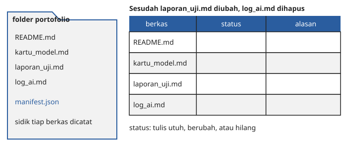

**Ingat dulu:** Tanpa melihat catatan, jawab. (1) Apa isi catatan model, dan mengapa model yang tidak dipilih tetap dicatat? ______ (2) Apa empat kolom satu baris laporan etika? ______



`[Gambar: folder portofolio berisi empat berkas (README.md, kartu_model.md, laporan_uji.md, log_ai.md) dan berkas manifest. Tabel di sampingnya punya kolom berkas, status sesudah diubah (utuh, berubah, atau hilang), dan alasan; dua kolom terakhir kosong. Keterangan: laporan_uji.md diubah satu angkanya dan log_ai.md dihapus.]`

**Prediksi:** Program membuat arsip kecil dengan manifest (nama, ukuran, sidik tiap berkas), lalu mengubah satu angka di `laporan_uji.md`, menghapus `log_ai.md`, dan menambahkan `catatan.md` berisi surel contoh. Tebak dulu, tulis pada gambar: apa yang dilaporkan verifikasi? Apa yang dilaporkan pemindai privasi? ______

**Lengkapi:** Isi bagian `____` agar verifikasi melaporkan berkas yang hilang dan yang berubah.

```python setengah-jadi
for nama, info in janji.items():
    b = folder / nama
    if not b.____():
        temuan.append(f"hilang: {nama}")
    elif sidik_berkas(b) ____ info["sidik"]:
        temuan.append(f"berubah: {nama}")
```

Apa yang tidak dijamin oleh manifest? ______

**Latihan:**

1. Tambahkan berkas `catatan_ulasan.md` setelah manifest dibuat. Apakah `verifikasi` menandainya? Jelaskan, lalu ubah fungsinya agar berkas yang tak tercatat ikut dilaporkan. `AI: boleh` ______
2. Dari `d-xii2-m4`: tulis lima isi laporan garis dasar dan tunjukkan di mana tiap isi ada di portofolio. `AI: tanpa AI` ______
3. Dari `d-xii2-m7`: sebutkan dua berkas portofolio yang memuat sidik kandidat dan satu yang memuat catatan perubahan. `AI: boleh` ______
4. Apa ciri refleksi yang baik, dan apa yang dilakukan sesudahnya? ______

**Cek diri:**

- [ ] Saya dapat membuat dan memverifikasi manifest portofolio.
- [ ] Saya dapat menyebut batas manifest dan pemindai.
- [ ] Saya dapat menulis refleksi dengan bukti dan rencana.

**Catatan cetak (untuk guru, tidak dicetak):** satu halaman A4, dicetak satu sisi. Kunci ada di modul `d-xii2-m13` bagian "Kunci dan petunjuk". Lembar tidak memuat kolom identitas (nama, kelas, tanggal, atau nilai).
