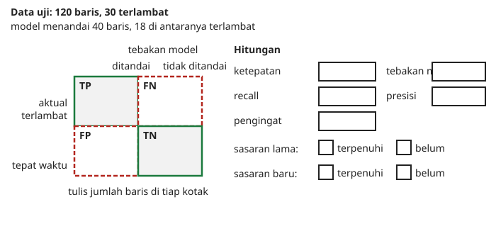

**Ingat dulu:** Asesmen ini tanpa AI dan tanpa catatan. (1) Mengapa pemindaian privasi dan manifest sidik hanya melengkapi, dan apa yang tidak dapat dijaminnya? ______ (2) Bagaimana menghitung ulang recall dari jumlah terdeteksi dan terlewat untuk mengecek angka laporan? ______ (3) Mengapa demo dengan tiga contoh bukan bukti ketepatan, dan apa yang dilakukan bila demo gagal? ______



`[Gambar: kiri, matriks kebingungan dua kali dua dengan baris aktual (terlambat, tepat waktu) dan kolom tebakan (ditandai, tidak ditandai), empat kotak kosong, serta keterangan data uji 120 baris dengan 30 terlambat dan model menandai 40 baris, 18 di antaranya terlambat. Kanan, kotak kosong untuk ketepatan, tebakan mayoritas, recall, presisi, pengingat, dan dua baris sasaran (lama dan baru) dengan pilihan terpenuhi atau belum.]`

**Prediksi:** Semua kolom dan label acak murni (25 persen positif), jadi presisi jujur sekitar 0,25. Program berikut memilih ambang dengan presisi terbaik pada data uji, lalu membandingkannya dengan data segar. Tebak dua angka keluarannya sebelum menjalankan: ______ dan ______ Jelaskan selisihnya, lalu tulis ulang pemilihan ambang agar data uji tidak dipakai memilih. ______

```python
import numpy as np
from sklearn.linear_model import LogisticRegression
from sklearn.metrics import precision_score
from sklearn.model_selection import train_test_split

GRID = [0.30, 0.35, 0.40, 0.45, 0.50, 0.55, 0.60, 0.65, 0.70, 0.75, 0.80]
dilaporkan, segar = [], []
for ulang in range(50):
    acak = np.random.default_rng(ulang)
    X = acak.normal(size=(200, 5))
    y = (acak.random(200) < 0.25).astype(int)  # label acak: tidak ada pola
    X_latih, X_uji, y_latih, y_uji = train_test_split(X, y, test_size=0.4, stratify=y, random_state=0)
    model = LogisticRegression(class_weight="balanced").fit(X_latih, y_latih)
    p_uji = model.predict_proba(X_uji)[:, 1]
    layak = [a for a in GRID if (p_uji >= a).sum() >= 5]  # paling sedikit 5 tanda
    terbaik = max(layak, key=lambda a: precision_score(y_uji, p_uji >= a, zero_division=0))
    dilaporkan.append(precision_score(y_uji, p_uji >= terbaik, zero_division=0))
    X_baru = acak.normal(size=(2000, 5))
    y_baru = (acak.random(2000) < 0.25).astype(int)
    segar.append(precision_score(y_baru, model.predict_proba(X_baru)[:, 1] >= terbaik, zero_division=0))
print(round(float(np.mean(dilaporkan)), 2), round(float(np.mean(segar)), 2))
```

**Latihan:** Kerjakan tanpa AI.

1. **Hitung.** Data uji karangan 120 baris: 30 terlambat. Model menandai 40 baris, 18 di antaranya memang terlambat. Isi gambar: hitung ketepatan, recall, presisi, dan bagian yang diingatkan, bandingkan ketepatan dengan tebakan mayoritas, lalu nilai sasaran lama (recall sedikitnya 0,60, presisi 0,50) dan sasaran baru (recall 0,55, presisi 0,35, pengingat paling banyak 0,35). ______
2. **Periksa kartu.** Kartu karangan "Tim Fiktif": "Model ini akurat 91 persen. Data: peminjaman perpustakaan sekolah. Fitur: tebal, hari, `nama_peminjam`. Evaluasi: ketepatan 0,91." Sebutkan empat kekurangan dan perbaikannya. ______
3. **Audit.** Hasil karangan per kelompok: kelompok P 80 baris, 20 terlambat, recall 0,70; kelompok Q 30 baris, 4 terlambat, recall 0,25. Tulis tiga kalimat audit yang menyebut apa yang boleh dan tidak boleh disimpulkan. ______
4. **Gerbang rilis.** Rancang dulu di kertas, lalu tulis `gerbang_rilis(tp, fp, fn, tn, sasaran, uji_dibuka)` yang mengembalikan daftar alasan penahan: data uji tidak dibuka tepat satu kali, recall atau presisi di bawah sasaran, atau pengingat melebihi `pengingat_maks`. Daftar kosong berarti boleh. ______

**Cek diri:**

- [ ] Saya dapat menghitung metrik dan menilainya terhadap sasaran dan pembanding.
- [ ] Saya dapat mengenali dan memperbaiki pemilihan ambang pada data uji.
- [ ] Saya menulis refleksi dengan bukti dan rencana belajar di buku catatanku sendiri.

**Catatan cetak (untuk guru, tidak dicetak):** dua halaman A4, dicetak satu sisi. Kunci ada di modul `d-xii2-m14` bagian "Kunci dan petunjuk". Lembar tidak memuat kolom identitas (nama, kelas, tanggal, atau nilai). Refleksi ditulis murid di buku sendiri dan tidak dikumpulkan.
