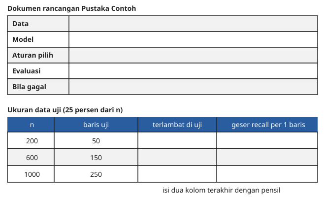

**Ingat dulu:** Tanpa melihat catatan, jawab. (1) Sebutkan empat hal yang membuat tabel eksperimen dapat diulang orang lain. ______ (2) Apa yang dilakukan bila ukuran sukses tidak tercapai, dan apa yang tidak boleh dilakukan? ______

`[Gambar: dua bagian. Atas: dokumen rancangan dengan lima baris berlabel Data, Model, Aturan pilih, Evaluasi, dan Bila gagal, tiap baris punya kotak isian kosong. Bawah: tabel dengan kolom n (200, 600, 1000), baris uji (25 persen dari n), terlambat di uji, dan geser recall per 1 baris; dua kolom terakhir kosong.]`

**Prediksi:** Pada `d-xii1-m6` data uji hanya 50 baris dengan 9 baris terlambat, sehingga satu baris menggeser recall 0,11. Tebak dulu, tulis pada tabel di gambar: bila data dibangkitkan 600 atau 1000 baris, berapa baris terlambat di data uji, dan berapa pergeseran per baris? Baru jalankan program pada modul.

Mengapa data uji sangat kecil tidak dapat dipercaya? ______

**Lengkapi:** Isi kelima baris dokumen rancangan pada gambar untuk topik Pustaka Contoh (tandai peminjaman yang mungkin terlambat): asal dan ukuran data, tiga kandidat model dari sederhana ke rumit, aturan pilih model yang ditulis sebelum hasil keluar, metrik beserta sasaran dan lipatan, dan tindakan bila gagal. `AI: tanpa AI`

**Latihan:**

1. Dari `d-xii1-m9`: sebutkan satu kolom yang tidak boleh masuk fitur Pustaka Contoh karena baru diketahui sesudah buku kembali, dan jelaskan alasannya. `AI: tanpa AI` ______
2. Dari `d-xii1-m7`: ubah aturan pilih agar memakai recall, bukan F1, dan jelaskan apa yang berubah pada keputusan. `AI: boleh` ______
3. Mengapa ukuran data uji dihitung sebelum data dibangkitkan, dan apa arti satu baris pada data uji kecil? ______
4. Apa yang dikunci di dokumen rancangan, dan mengapa sidik jari dipakai? ______

**Cek diri:**

- [ ] Saya dapat menulis rancangan data, model, evaluasi, dan tindakan bila gagal.
- [ ] Saya dapat menghitung ukuran data uji dan menjelaskan pilihannya.
- [ ] Saya dapat menulis aturan pilih model sebelum hasil keluar.

**Catatan cetak (untuk guru, tidak dicetak):** satu halaman A4, dicetak satu sisi. Kunci ada di modul `d-xii2-m2` bagian "Kunci dan petunjuk". Lembar tidak memuat kolom identitas (nama, kelas, tanggal, atau nilai).
