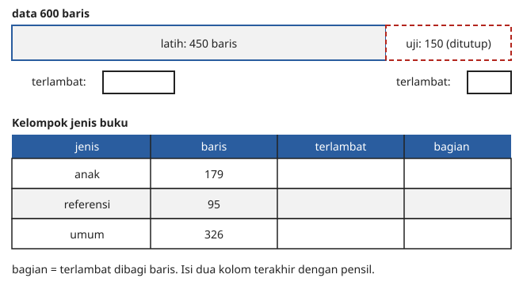

**Ingat dulu:** Tanpa melihat catatan, jawab. (1) Sebutkan empat hal yang diperiksa pada data sebelum model dibangun. ______ (2) Mengapa ukuran data uji dihitung sebelum data dibangkitkan? ______



`[Gambar: satu batang berlabel data 600 baris terbagi dua: latih 450 baris dan uji 150 baris (ditutup). Di bawah tiap bagian ada kotak kosong untuk jumlah baris terlambat. Di bawah batang, tabel kelompok jenis (anak, referensi, umum) dengan kolom baris, terlambat, dan bagian; kolom terlambat dan bagian kosong, dan kolom baris terisi 179, 95, 326.]`

**Prediksi:** Data karangan Pustaka Contoh 600 baris (uji 25 persen, ditutup) diperiksa dan dibagi. Tebak dulu, tulis pada gambar, baru jalankan: apakah pemeriksa menemukan masalah pada data ini? ______ Berapa baris terlambat di data latih dan di data uji? Apakah ada baris yang isinya sama persis dengan baris lain padahal kodenya berbeda? ______

**Lengkapi:** Setelah menjalankan program pada modul, isi kolom terlambat dan bagian pada tabel kelompok (bagian = terlambat dibagi baris), lalu tulis kelompok mana yang buktinya paling tipis dan mengapa jumlah baris ditulis di samping angkanya. `AI: tanpa AI` ______

Lalu isi bagian `____` agar program membuktikan tidak ada kode yang bocor ke kedua bagian.

```python setengah-jadi
print("kode yang ada di latih dan uji sekaligus:", len(set(latih["kode"]) ____ set(uji["kode"])))
```

**Latihan:**

1. Dari `d-xii1-m2`: kelompok `referensi` pada `d-xii1-m5` hanya 25 baris. Mengapa persen kelompok itu sebaiknya tidak ditulis tanpa jumlah barisnya? `AI: tanpa AI` ______
2. Dari `d-xii1-m10`: mengapa catatan data menulis benih dan versi pustaka bersama sidik berkas? `AI: boleh` ______
3. Apa yang dilakukan bila pemeriksaan menemukan masalah data, selain membuang barisnya diam-diam? ______
4. Buat salinan rusak dari datamu: hapus lima nilai dan gandakan tiga baris. Lalu jalankan pemeriksa dan catat temuannya. `AI: boleh` ______

**Cek diri:**

- [ ] Saya dapat menjalankan dan menguji pemeriksaan data.
- [ ] Saya dapat membagi data dan membuktikan tidak ada kebocoran kode.
- [ ] Saya dapat menulis catatan kualitas data dengan sidik berkas.

**Catatan cetak (untuk guru, tidak dicetak):** satu halaman A4, dicetak satu sisi. Kunci ada di modul `d-xii2-m3` bagian "Kunci dan petunjuk". Lembar tidak memuat kolom identitas (nama, kelas, tanggal, atau nilai).
