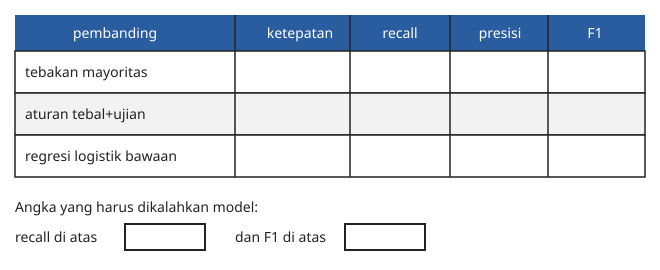

**Ingat dulu:** Tanpa melihat catatan, jawab. (1) Mengapa perubahan versi pustaka atau benih dapat mengubah angka, dan bagaimana kamu menjaganya? ______ (2) Apa empat syarat topik yang layak? ______



`[Gambar: tabel dengan tiga baris pembanding (tebakan mayoritas, aturan tebal+ujian, regresi logistik bawaan) dan empat kolom metrik: ketepatan, recall, presisi, dan F1. Semua sel metrik kosong untuk kamu isi dengan rata-rata lima lipatan. Di bawah tabel ada kotak angka yang harus dikalahkan model.]`

**Prediksi:** Pembanding dinilai pada lima lipatan data latih (450 baris), sedangkan data uji ditutup. Tebak dulu, tulis pada gambar: berapa ketepatan tebakan "selalu tepat waktu" dan berapa recall-nya? Menurutmu, mana yang recall-nya lebih tinggi, aturan tulisan tangan atau regresi logistik bawaan? ______

**Lengkapi:** Aturan tulisan tangan menandai buku yang tebalnya mencapai ambang tertentu pada musim ujian. Isi bagian `____` dengan nilai dari aturan pada modul.

```python setengah-jadi
def predict(self, X):
    return ((X["tebal"] >= ____) & (X["musim_ujian"] == ____)).astype(int).to_numpy()
```

Mengapa aturan ini tidak boleh dipilih dengan melihat data uji? ______

**Latihan:**

1. Dari `d-xii2-m2`: sasaran proyek ditulis di dokumen rancangan yang dikunci. Bila garis dasar menunjukkan sasaran presisi sulit dicapai, apa yang boleh dan tidak boleh kamu lakukan? `AI: tanpa AI` ______
2. Dari `d-xii1-m6`: tebakan mayoritas pada data uji kecil bisa tampak sama baik dengan model. Mengapa lipatan dengan sebaran lebih jujur daripada satu angka? `AI: boleh` ______
3. Sebutkan lima isi laporan garis dasar. ______
4. Mengapa slide hasil selalu memuat pembanding sederhana di samping model? ______

**Cek diri:**

- [ ] Saya dapat membuat pembanding dan menilainya pada lipatan.
- [ ] Saya dapat memilih metrik utama dan menjelaskan alasannya.
- [ ] Saya dapat menulis laporan garis dasar dengan angka yang harus dikalahkan.

**Catatan cetak (untuk guru, tidak dicetak):** satu halaman A4, dicetak satu sisi. Kunci ada di modul `d-xii2-m4` bagian "Kunci dan petunjuk". Lembar tidak memuat kolom identitas (nama, kelas, tanggal, atau nilai).
