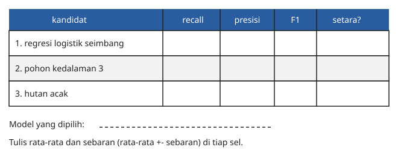

**Ingat dulu:** Tanpa melihat catatan, jawab. (1) Mengapa jumlah baris tiap kelompok ditulis di samping angkanya? ______ (2) Apa yang dikunci di dokumen rancangan, dan mengapa sidik jari dipakai? ______



`[Gambar: tabel dengan tiga baris kandidat dari sederhana ke rumit: regresi logistik seimbang, pohon kedalaman 3, dan hutan acak. Kolom: recall, presisi, F1, dan setara dengan yang tertinggi (ya atau tidak). Semua sel kosong. Di bawah tabel ada garis untuk model yang dipilih.]`

**Prediksi:** Dari `d-xii2-m4`, aturan tulisan tangan memiliki recall 0,34. Tebak dulu, tulis, baru jalankan: apakah ketiga model mengalahkannya? ______ Apakah model yang paling rumit pasti menang? ______ Model mana yang dipilih oleh aturan "F1 tertinggi; selisih yang tidak melebihi sebaran dianggap setara, lalu pilih yang paling sederhana"? ______

**Lengkapi:** Fungsi `pilih` mengambil model ber-F1 tertinggi, mengumpulkan model yang setara dengannya, lalu memilih yang paling sederhana. Isi bagian `____`.

```python setengah-jadi
def pilih(hasil):
    terbaik = max(hasil, key=lambda nama: hasil[nama]["f1"][0])
    rata, sebaran = hasil[terbaik]["f1"]
    setara = [nama for nama in hasil if rata - hasil[nama]["f1"][0] ____ sebaran]
    return terbaik, setara, setara[____]  # dict menjaga urutan sederhana ke rumit
```

**Latihan:**

1. Dari `d-xii2-m4`: model baru dengan recall 0,36 mengalahkan aturan tulisan tangan 0,34 pada sebaran 0,07. Apa yang kamu katakan? `AI: tanpa AI` ______
2. Dari `d-xii1-m7`: hutan acak berbeda hasil bila benihnya diganti. Apa yang kamu catat, dan bagaimana kamu memeriksa kestabilan pilihanmu? `AI: boleh` ______
3. Apa saja yang harus sama agar tiga model dibandingkan secara adil? ______
4. Apa isi catatan model, dan mengapa model yang tidak dipilih tetap dicatat? ______

**Cek diri:**

- [ ] Saya dapat membandingkan tiga model secara adil.
- [ ] Saya dapat menilai selisih terhadap sebaran.
- [ ] Saya dapat memilih model dengan aturan tertulis.

**Catatan cetak (untuk guru, tidak dicetak):** satu halaman A4, dicetak satu sisi. Kunci ada di modul `d-xii2-m5` bagian "Kunci dan petunjuk". Lembar tidak memuat kolom identitas (nama, kelas, tanggal, atau nilai).
