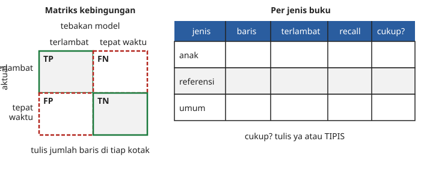

**Ingat dulu:** Tanpa melihat catatan, jawab. (1) Apa tiga tingkat klaim pada narasi hasil, dan beri satu contoh tiap tingkat? ______ (2) Apa saja yang harus sama agar tiga model dibandingkan secara adil? ______



`[Gambar: kiri, matriks kebingungan dua kali dua: baris aktual terlambat dan tepat waktu, kolom tebakan terlambat dan tepat waktu, dengan empat kotak berlabel TP, FN, FP, dan TN yang kosong. Kanan, tabel per jenis (anak, referensi, umum) dengan kolom baris, terlambat, recall, dan cukup bukti; semua sel kosong.]`

**Prediksi:** Model terpilih (regresi logistik seimbang) menebak tiap baris data latih di luar lipatan; data uji tidak disentuh. Tebak dulu, tulis, baru jalankan: jenis buku mana yang recall-nya terendah? ______ Apakah buku yang terlewat cenderung tebal atau tipis? ______ Seperti apa tanda palsu yang paling yakin? ______

**Lengkapi:** Isi bagian `____` agar recall dan presisi dihitung dari matriks kebingungan.

```python setengah-jadi
tn, fp, fn, tp = confusion_matrix(g["terlambat"], g["tebakan"]).ravel()
print(f"recall={tp / (tp + ____):.2f} presisi={tp / (tp + ____):.2f}")
```

Setelah menjalankan program pada modul, isi matriks dan tabel pada gambar, lalu tandai kelompok yang buktinya tipis. ______

**Latihan:**

1. Dari `d-xii2-m4`: angka yang harus dikalahkan adalah recall 0,34. Apakah model terpilih mengalahkannya, dan dengan sebaran berapa? `AI: tanpa AI` ______
2. Dari `d-xii1-m11`: tambahkan satu baris pada laporan risiko berdasarkan temuan buku anak: risiko, bukti, tindakan, dan risiko yang tersisa. `AI: boleh` ______
3. Mengapa galat dibaca baris demi baris, dan apa yang dicatat dari tiap kelompok galat? ______
4. Mengapa angka per kelompok ditulis bersama jumlah barisnya, dan mengapa tebakan di luar lipatan bukan angka laporan resmi? ______

**Cek diri:**

- [ ] Saya dapat membaca matriks kebingungan dan tabel per kelompok.
- [ ] Saya dapat mengelompokkan galat menjadi hipotesis.
- [ ] Saya dapat menulis klaim dalam tiga tingkat.

**Catatan cetak (untuk guru, tidak dicetak):** satu halaman A4, dicetak satu sisi. Kunci ada di modul `d-xii2-m6` bagian "Kunci dan petunjuk". Lembar tidak memuat kolom identitas (nama, kelas, tanggal, atau nilai).
