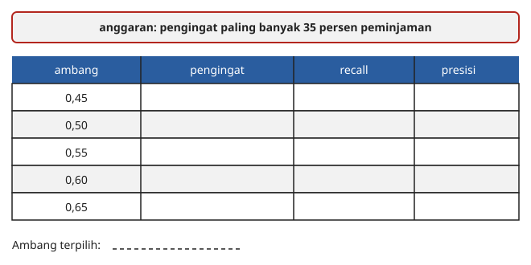

**Ingat dulu:** Tanpa melihat catatan, jawab. (1) Kapan data uji dibuka, berapa kali, dan mengapa? ______ (2) Mengapa galat dibaca baris demi baris, dan apa yang dicatat dari tiap kelompok galat? ______



`[Gambar: tabel dengan lima baris ambang 0,45, 0,50, 0,55, 0,60, dan 0,65, dan kolom pengingat (bagian peminjaman yang ditandai), recall, dan presisi yang kosong. Di atas tabel ada kotak anggaran pengingat 35 persen. Di bawah ada garis untuk ambang terpilih.]`

**Prediksi:** Dua hipotesis dari analisis galat: (S1) fitur turunan `tebal_per_hari` membantu model menangkap buku tebal berjangka pendek; (S2) ambang keputusan perlu dinaikkan karena tanda terlalu banyak. Pengguna fiktif hanya sanggup mengirim pengingat untuk 35 persen peminjaman. Tebak dulu, tulis, baru jalankan: apakah S1 menaikkan F1 melebihi sebarannya? ______ Pada ambang berapa tanda masih di bawah 35 persen? ______

**Lengkapi:** Isi bagian `____` agar ambang terpilih adalah yang terendah di grid yang bagian tandanya masih dalam anggaran.

```python setengah-jadi
grid = [round(0.30 + 0.05 * i, 2) for i in range(11)]
AMBANG = ____(a for a in grid if (peluang >= a).mean() ____ ANGGARAN)
print("ambang terpilih:", AMBANG)
```

Setelah menjalankan program pada modul, isi tabel pada gambar dan tulis ambang terpilih. Mengapa ambang dipilih dari tebakan di luar lipatan, bukan dari data uji? ______

**Latihan:**

1. Dari `d-xii2-m5`: S1 tidak dipakai karena selisihnya di dalam sebaran. Tulis baris tabel eksperimen untuk S1 dengan hipotesis, perubahan, hasil, dan keputusan. `AI: boleh` ______
2. Dari `d-xii2-m2`: apa yang berubah pada sidik rancangan bila sasaran diubah, dan mengapa catatan perubahan tetap diperlukan? `AI: tanpa AI` ______
3. Kapan sasaran boleh diubah, dan apa yang dicatat dalam catatan perubahan? ______
4. Apa arti rilis kandidat, dan apa yang dibekukan sebelum data uji dibuka? ______

**Cek diri:**

- [ ] Saya dapat menguji satu perubahan terhadap sebaran.
- [ ] Saya dapat memilih ambang dari anggaran tanpa data uji.
- [ ] Saya dapat menulis catatan perubahan sasaran yang terbuka.

**Catatan cetak (untuk guru, tidak dicetak):** satu halaman A4, dicetak satu sisi. Kunci ada di modul `d-xii2-m7` bagian "Kunci dan petunjuk". Lembar tidak memuat kolom identitas (nama, kelas, tanggal, atau nilai).
