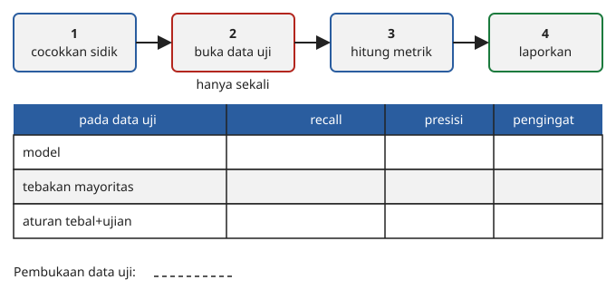

**Ingat dulu:** Tanpa melihat catatan, jawab. (1) Apa arti rilis kandidat, dan apa yang dibekukan sebelum data uji dibuka? ______ (2) Mengapa tebakan mayoritas berketepatan tinggi tetapi tidak berguna, dan metrik apa yang membuktikannya? ______



`[Gambar: diagram alir empat kotak berurutan dengan panah: 1 cocokkan sidik, 2 buka data uji (sekali), 3 hitung metrik, 4 laporkan. Di bawahnya tabel tiga baris (model, tebakan mayoritas, aturan tebal+ujian) dengan kolom recall, presisi, dan pengingat yang kosong, serta satu garis kosong untuk jumlah pembukaan data uji.]`

**Prediksi:** Pengujian akhir adalah satu peristiwa. Sasaran yang dipakai adalah sasaran baru (recall 0,55, presisi 0,35, pengingat paling banyak 0,35) dari catatan perubahan. Angka lipatan model adalah recall 0,58 dan presisi 0,40. Tebak dulu, tulis, baru jalankan: apakah recall dan presisi uji lebih tinggi atau lebih rendah daripada angka lipatan? ______ Apakah model mengalahkan aturan tulisan tangan di keduanya? ______

**Lengkapi:** Isi bagian `____` agar fungsi menghitung recall dan presisi dari tebakan `tanda` dan label `y`.

```python setengah-jadi
def hitung(y, tanda):
    tp = int(((tanda == 1) & (y == 1)).sum())
    fp = int(((tanda == 1) & (y == 0)).sum())
    fn = int(((tanda == ____) & (y == ____)).sum())
    recall = tp / (tp + fn) if tp + fn else 0.0
    presisi = tp / (tp + ____) if tp + fp else 0.0
    return recall, presisi
```

Setelah menjalankan program pada modul, isi tabel pada gambar.

**Latihan:**

1. Dari `d-xii2-m6`: tulis klaim tiga tingkat untuk model dan aturan tulisan tangan pada data uji ini. `AI: boleh` ______
2. Dari `d-xii1-m6`: dengan 36 peminjaman terlambat, berapa pergeseran recall per baris, dan mengapa itu penting saat menyatakan sasaran terpenuhi? `AI: tanpa AI` ______
3. Mengapa data uji dibuka satu kali saja, dan apa yang dilakukan bila hasilnya tidak mencapai sasaran? ______
4. Mengapa angka laporan uji ditulis bersama selang kasar dan jumlah barisnya? ______

**Cek diri:**

- [ ] Saya dapat mencocokkan sidik sebelum membuka data uji.
- [ ] Saya dapat melaporkan selang kasar dan angka per kelompok.
- [ ] Saya dapat menulis klaim yang tidak lebih kuat daripada buktinya.

**Catatan cetak (untuk guru, tidak dicetak):** satu halaman A4, dicetak satu sisi. Kunci ada di modul `d-xii2-m8` bagian "Kunci dan petunjuk". Lembar tidak memuat kolom identitas (nama, kelas, tanggal, atau nilai).
