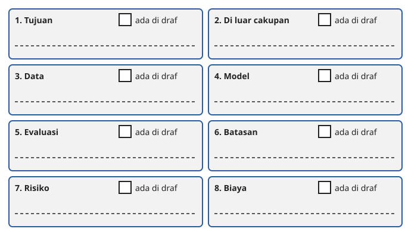

**Ingat dulu:** Tanpa melihat catatan, jawab. (1) Mengapa kartu model menyebut kelompok yang kinerjanya lebih rendah? ______ (2) Apa saja bagian kartu model, dan baris mana yang menyatakan ketidakpastian? ______



`[Gambar: kartu model berisi delapan kotak berlabel Tujuan, Di luar cakupan, Data, Model, Evaluasi, Batasan, Risiko, dan Biaya. Tiap kotak punya kotak centang kecil berlabel ada di draf dan satu garis kosong untuk isi bagian itu.]`

**Prediksi:** Draf kartu di bawah memuat beberapa kekurangan. Sebelum menjalankan program pemeriksa pada modul, centang pada gambar bagian yang ada di draf, lalu tebak dan tulis kekurangan lainnya. ______

```python
DRAF = {
    "nama": "Penanda keterlambatan Pustaka Contoh",
    "Tujuan": "Membantu petugas memilih peminjaman yang diingatkan lebih awal.",
    "Data": "Data karangan.",
    "Model": "Regresi logistik. Model ini akurat 95 persen.",
    "Evaluasi": "Recall 0,56.",
}
```

**Lengkapi:** Isi bagian `____` agar pemeriksa bentuk kartu menangkap bagian yang hilang dan label karangan yang tidak ada.

```python setengah-jadi
def periksa(teks):
    temuan = []
    for bagian in BAGIAN:
        if f"## {bagian}" ____ teks:
            temuan.append(f"bagian hilang: {bagian}")
    if "karangan" not in teks.____():
        temuan.append("tidak ada label karangan atau sintetis")
    return temuan
```

Apa yang tidak dapat diperiksa program ini? ______

**Latihan:**

1. Tulis bagian Batasan kartu proyekmu, minimal tiga butir, masing-masing dengan alasannya. `AI: boleh` ______
2. Dari `d-xii2-m3`: bagian Data kartu harus memuat apa dari catatan kualitas data? `AI: tanpa AI` ______
3. Dari `d-xii2-m7`: di bagian mana kartu mencatat sasaran lama dan perubahan sasaran? `AI: boleh` ______
4. Mengapa kartu model memuat bagian "di luar cakupan"? ______

**Cek diri:**

- [ ] Saya dapat menyusun kartu model dengan delapan bagian dari laporan uji.
- [ ] Saya dapat menyebut apa yang tidak dapat diperiksa program pemeriksa.
- [ ] Saya mencatat label karangan, sidik, dan pemakaian AI.

**Catatan cetak (untuk guru, tidak dicetak):** satu halaman A4, dicetak satu sisi. Kunci ada di modul `d-xii2-m9` bagian "Kunci dan petunjuk". Lembar tidak memuat kolom identitas (nama, kelas, tanggal, atau nilai).
