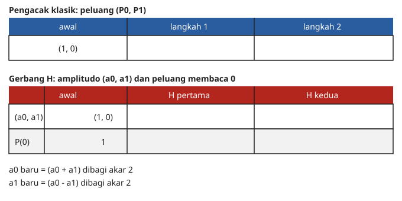

**Ingat dulu:** Tanpa melihat catatan, jawab. (1) Berapa pola berbeda yang bisa disimpan 3 bit, dan mengapa? ______ (2) Berapa nilai `NOT (p AND q)` bila `p` = 1 dan `q` = 0? ______ (3) Bolehkah sebuah fungsi memberi dua keluaran berbeda untuk satu masukan yang sama? ______



`[Gambar: tabel dengan dua blok. Blok atas, pengacak klasik: kolom awal, langkah 1, dan langkah 2, tiap kolom memuat pasangan peluang (P0, P1); kolom awal terisi (1, 0), dua kolom lain kosong. Blok bawah, gerbang H: kolom awal, H pertama, dan H kedua, tiap kolom memuat pasangan amplitudo (a0, a1) dan peluang membaca 0; kolom awal terisi (1, 0), sisanya kosong. Di bawah tabel tertulis: a0 baru = (a0 + a1) dibagi akar 2, a1 baru = (a0 - a1) dibagi akar 2.]`

**Prediksi:** Dua mesin, keduanya mulai dari 0. Mesin klasik: "pengacak" mengubah bit menjadi 0 atau 1 dengan peluang sama, apa pun masukannya. Mesin kuantum di Quirk: gerbang H menaruh qubit pada keadaan yang saat dibaca memberi 0 atau 1 dengan peluang sama. Tebak dulu, tulis: (1) setelah pengacak dipakai dua kali, berapa peluang bit terbaca 0? ______ (2) Setelah H dipakai dua kali, berapa peluang qubit terbaca 0? ______ Beri satu kalimat alasan. ______

**Lengkapi:** Isi tabel pada gambar dengan angka (empat desimal), lalu lengkapi.

1. Mulai dari `(1, 0)`. Setelah H: `a0 = (1 + 0)/akar2 = ____` dan `a1 = (1 - 0)/akar2 = ____`.
2. Setelah H kedua dari `(0,7071 ; 0,7071)`: `a0 = ____` dan `a1 = ____`. Peluang membaca 0 adalah ____ dan membaca 1 adalah ____.
3. Mengapa pengacak klasik tidak bisa kembali ke `(1, 0)`, sedangkan H dua kali bisa? ______

**Susun:** Urutkan baris A sampai F menjadi perulangan yang menerapkan H dua kali. Kedua nilai baru harus dihitung sebelum salah satu nilai lama diganti. `AI: tanpa AI`

```text
(A) a0 = baru0;
(B) double baru0 = (a0 + a1) / akar2;
(C) a1 = baru1;
(D) for (int langkah = 1; langkah <= 2; langkah++) {
(E) double baru1 = (a0 - a1) / akar2;
(F) }
```

Urutanku: ____ , ____ , ____ , ____ , ____ , ____

**Latihan:**

1. Mulai dari `(1, 0)`, pakai pengacak klasik tiga kali. Tulis peluang 0 setelah tiap langkah. `AI: tanpa AI` ______
2. Tebak `Chance` di Quirk bila H dipakai tiga kali, lalu coba dan jelaskan dengan hitungan tangan. `AI: boleh` ______
3. Untuk tiap klaim tulis fakta atau mitos dan satu alasan: (a) komputer kuantum mencoba semua jawaban sekaligus dan langsung membaca yang benar; (b) membaca satu qubit sekali memberi 0 atau 1; (c) H dua kali pada `(1, 0)` mengembalikannya ke `(1, 0)`; (d) komputer kuantum membuat semua program lebih cepat. `AI: tanpa AI` ______
4. Gerbang NOT klasik membalik bit. Mengapa dua kali NOT mengembalikan bit, tetapi dua kali pengacak tidak? ______

**Cek diri:**

- [ ] Saya dapat membedakan bit klasik, bit acak klasik, dan qubit secara garis besar.
- [ ] Saya dapat menyebut satu hal yang dijanjikan dan satu yang bukan dijanjikan komputasi kuantum.
- [ ] Saya dapat membaca `Chance` di Quirk dan menghitung H dua kali dengan tangan.

**Catatan cetak (untuk guru, tidak dicetak):** satu halaman A4, dicetak satu sisi. Kunci ada di modul `e-xi1-m1` bagian "Kunci dan petunjuk". Lembar tidak memuat kolom identitas (nama, kelas, tanggal, atau nilai).
