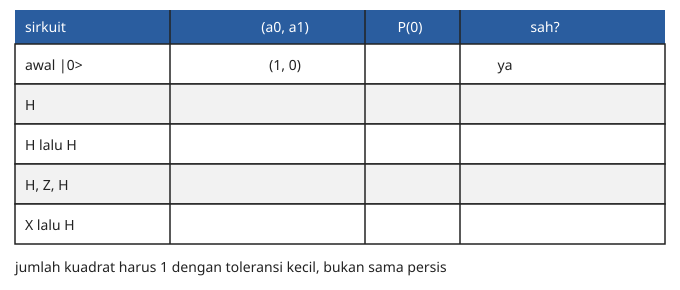

**Ingat dulu:** Tanpa melihat catatan, jawab. (1) Mengapa jumlah kuadrat komponen vektor yang sudah dinormalkan sama dengan 1? ______ (2) Mengapa histogram 1000 shot dari keadaan `(0,6 ; 0,8)` tidak persis 360 dan 640? ______ (3) Tulis sirkuit H, Z, H sebagai satu matriks: gerbang mana yang ditulis paling kanan, dan apa hasilnya? ______



`[Gambar: tabel lima baris sirkuit: awal |0>, H, H lalu H, H Z H, dan X lalu H. Baris awal sudah terisi amplitudo (1, 0). Kolom amplitudo (a0, a1), P(0), dan sah (ya atau TIDAK) kosong untuk baris lainnya. Di bawah tabel tertulis: jumlah kuadrat harus 1 dengan toleransi kecil, bukan sama persis.]`

**Prediksi:** Sebuah simulator menyimpan keadaan sebagai larik `(a0, a1)` dan menerapkan gerbang dengan perkalian matriks-vektor. Tebak dulu, tulis: (1) berapa bilangan yang disimpan untuk keadaan satu qubit, dan berapa untuk satu gerbang? ______ (2) Bila simulator menerapkan H lalu H pada `(1, 0)`, apa yang tercetak? ______ (3) Mengapa simulator perlu memeriksa jumlah kuadrat hasilnya? ______ Lalu isi tabel pada gambar dengan hitungan tangan.

**Lengkapi:**

1. Keadaan satu qubit disimpan dalam larik berukuran ____, gerbang dalam matriks ____ x ____.
2. Lengkapi perkalian matriks-vektor dan pemeriksaan sah:

```cpp setengah-jadi
Vektor terapkan(const Matriks& gerbang, const Vektor& keadaan) {
    Vektor hasil(keadaan.size(), 0.0);
    for (size_t baris = 0; baris < gerbang.size(); baris++) {
        for (size_t kolom = 0; kolom < keadaan.size(); kolom++) {
            hasil[____] += gerbang[____][____] * keadaan[____];
        }
    }
    return hasil;
}

bool sah(const Vektor& keadaan) {
    return std::fabs(jumlahKuadrat(keadaan) ____ 1.0) < ____;
}
```

**Susun:** Urutkan baris A sampai E menjadi fungsi `jumlahKuadrat`. `AI: tanpa AI`

```text
(A) double jumlahKuadrat(const Vektor& keadaan) {
(B) double total = 0;
(C) for (double amplitudo : keadaan) total += amplitudo * amplitudo;
(D) return total;
(E) }
```

Urutanku: ____ , ____ , ____ , ____ , ____

**Latihan:**

1. Bila `main` ditambah `tampilkan("X lalu Z", terapkan(Z, terapkan(X, nol)));`, apa yang tercetak? Tulis dulu, baru jalankan. `AI: tanpa AI` ______
2. Matriks `[[0,6 ; 0,8], [0,8 ; -0,6]]` dipakai pada `(1, 0)`, `(0, 1)`, dan `(0,6 ; 0,8)`. Dengan tangan lalu dengan program, apakah ia gerbang yang sah? `AI: boleh` ______
3. Keadaan `(0,6 ; 0,8)` diberi gerbang Z. Tulis vektor hasil dan peluang membaca 0. ______
4. Keadaan `(3, 4)` dinormalkan menjadi apa, dan mengapa simulator sebaiknya memeriksanya sebelum membaca? ______

**Cek diri:**

- [ ] Saya dapat menyimpan vektor keadaan dan matriks gerbang dalam program.
- [ ] Saya dapat memeriksa keadaan sah dengan toleransi.
- [ ] Saya dapat menjalankan sirkuit di simulatorku dan mencocokkannya dengan hitungan tangan.

**Catatan cetak (untuk guru, tidak dicetak):** satu halaman A4, dicetak satu sisi. Kunci ada di modul `e-xi1-m10` bagian "Kunci dan petunjuk". Lembar tidak memuat kolom identitas (nama, kelas, tanggal, atau nilai).
